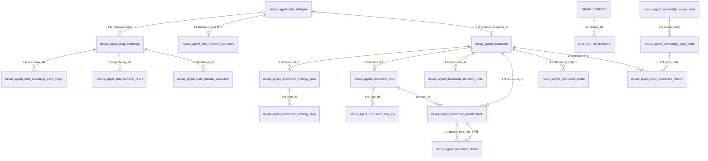

# Nexus Agent 后端开发手册

> 适用版本：`org.javaup:nexus-agent:0.0.1-SNAPSHOT`（基于 `pom.xml:25`）
> 适用对象：参与 nexus-agent-business-chat 模块及公共框架二次开发的后端工程师
> 文档基线代码：本仓库 `superagent-understanding/` 目录下的实际源码

---

## 目录

1. [项目概述](#1-项目概述)
2. [系统架构](#2-系统架构)
3. [目录结构](#3-目录结构)
4. [环境部署](#4-环境部署)
5. [数据库设计](#5-数据库设计)
6. [API 接口文档](#6-api-接口文档)
7. [核心模块说明](#7-核心模块说明)
8. [开发规范](#8-开发规范)
9. [常见问题](#9-常见问题)

---

## 1. 项目概述

### 1.1 项目定位

Nexus Agent 是一个**企业级多编排 AI 智能体对话平台**，定位为生产可用的 AI 应用工程参考实现。

- 服务端（`nexus-agent-business-chat`）：Spring Boot 3.5.6 + Java 17 单体应用，对外暴露 SSE 流式对话、管理后台、文档治理与知识库治理接口。
- 客户端（`vue/`）：Vue 3 + Vite 前端工程，对接对话流和管理后台 UI。
- `ai-example/`：基于 Spring AI、Spring AI Alibaba 的演示工程集合（MCP、RAG、Memory、Agent 等），用于学习与回归测试。

代码许可协议：Apache-2.0（`LICENSE`）。

### 1.2 业务目标

根据 `README.md` 第 42-49 行的项目描述，业务目标可以拆解为六条主线：

1. **ReAct Agent 完整实现**：支持联网搜索、工具调用、多步推理、Checkpoint 持久化。
2. **三层执行器体系**：先做确定性编排，再按场景选择歧义追问 / RAG 知识问答 / ReAct Agent。
3. **Neo4j 文档结构图谱**：每份文档在索引构建时生成 `Document → Section → Item` 的图结构。
4. **知识路由三级漏斗**：`Scope → Topic → Document` 自动锁定最相关的知识范围。
5. **影子路由质量观测**：用户手动选择文档时，系统静默运行知识路由以评估推荐质量。
6. **RAG 前置编排引擎**：路由判定、问题改写、子问题拆分、知识域收缩、歧义澄清五步决策链。

### 1.3 技术栈

| 分类 | 选型 | 出处 |
| --- | --- | --- |
| JDK | Java 17 | `pom.xml:28` |
| Web 框架 | Spring Boot 3.5.6 | `pom.xml:29` |
| AI 框架 | Spring AI 1.1.0 + Spring AI Alibaba 1.1.2.0 | `pom.xml:30-31` |
| ORM | MyBatis-Plus 3.5.7 | `pom.xml:38` |
| 缓存 | Redis + Redisson 3.32.0 | `pom.xml:49` |
| 消息队列 | Spring Kafka | `nexus-agent-business-chat/pom.xml:115-117` |
| 对象存储 | MinIO 8.5.17 | `nexus-agent-business-chat/pom.xml:118-122` |
| 文档解析 | Apache Tika 3.2.3（core + standard-package） | `nexus-agent-business-chat/pom.xml:124-132` |
| 全文检索 | Elasticsearch（`spring-boot-starter-data-elasticsearch`） | `nexus-agent-business-chat/pom.xml:134-136` |
| 向量库 | PostgreSQL + pgvector | `application.yaml:303-324` |
| 图数据库 | Neo4j Java Driver | `nexus-agent-business-chat/pom.xml:138-140` |
| 鉴权 | JJWT 0.9.1 + 自研 Interceptor | `pom.xml:33` + `auth/support/AdminAuthInterceptor.java` |
| 接口文档 | springdoc-openapi 2.2.0 + knife4j 4.3.0 | `pom.xml:46-47` |
| 工具集 | Hutool 5.8.25、Fastjson 1.2.83、commons-lang 2.6、commons-collections 3.2.2 | `pom.xml:32-48` |
| 日志 | Log4j2（替换 spring-boot-starter-logging） | `nexus-agent-business-chat/pom.xml:71-72` 与 `resources/log4j2.xml` |
| 前端 | Vue 3 + Vite（`vue/`） | `vue/package.json`（目录存在） |
| 主类入口 | `org.javaup.ai.NexusBusinessChatAgentApplication` | `nexus-agent-business-chat/pom.xml:163` |

### 1.4 功能清单

| 模块 | 关键能力 | 主要入口 |
| --- | --- | --- |
| 对话执行 | SSE 流式对话、推荐追问、停问、续问、租约互斥、Checkpoint 持久化 | `BusinessChatController.java:42` |
| 对话归档 | 会话/轮次/摘要/轨迹/检索快照的 MySQL 存储与查询 | `ConversationArchiveStore` / `MybatisConversationArchiveStore` |
| 知识问答（RAG） | 问题改写、子问题拆分、双通道检索、RRF 融合、Rerank 精排、Parent-Child 聚合、证据预算 | `rag/service/ChatPreparationOrchestrator.java` |
| 三层执行器 | Clarification / Retrieval / Graph-Only / Graph+Evidence / ReAct Agent | `rag/executor/*Executor.java` |
| 文档治理 | 上传、解析、策略推荐、策略确认、切块、向量化、入库、删除、查询 | `DocumentManageController.java` |
| 知识库治理 | Scope / Topic / 主题-文档关联 / 文档画像 / 路由追踪 | `KnowledgeManageController.java` |
| 后台管理 | 账号登录、JWT、登出、当前用户查询、Preview 只读拦截 | `AdminAuthController.java` + `auth/support/AdminAuthInterceptor.java` |
| 基础设施 | 雪花 ID 生成、Redis 缓存、Redisson 分布式锁/限流/租约、ES IK 字典 | `nexus-agent-id-generator-framework`、`nexus-agent-redis-tool-framework`、`nexus-agent-redisson-framework` |
| 外部工具 | Tavily 联网搜索（指数退避重试 + 异常兜底） | `tool/TavilySearchTool.java`、`support/TavilyToolInputFallbackInterceptor.java` |

---

## 2. 系统架构

### 2.1 分层架构

整个后端遵循"业务编排 + 基础框架"的双层 Maven 结构（见 `pom.xml:15-22`）：

```
| 层级 | 模块 | 角色 |
| --- | --- | --- |
| 应用业务层 | nexus-agent-business / nexus-agent-business-chat | 对话编排、文档治理、控制器、DTO/VO |
| 通用基础层 | nexus-agent-common / nexus-agent-common-frame | 枚举、常量、异常、工具类 |
| 通用 Web 层 | nexus-agent-common-web | MyBatis-Plus 自动装配、分页、Swagger、Jackson 配置 |
| ID 生成层 | nexus-agent-id-generator-framework | 基于百度 UidGenerator 的雪花 ID |
| Redis 工具层 | nexus-agent-redis-tool-framework | Redis 缓存、Key 管理 |
| 分布式锁/限流层 | nexus-agent-redisson-framework | Redisson 分布式锁、限流、租约、延时队列 |
| AI 演示层 | ai-example/* | Spring AI 与 Spring AI Alibaba 教程样例 |
```

业务代码内部分包采用 DDD 风格：

```
org.javaup.ai
├── auth                 # 后台鉴权（Controller / Service / Interceptor / JWT）
├── chatagent            # 对话域（Controller / Service / DTO / VO / 数据对象 / Mapper）
│   ├── config           # ChatAgent 配置、Tavily 搜索配置
│   ├── controller       # 对话 Controller
│   ├── data             # 归档数据对象（dialogue、exchange、checkpoint、retrieval_result 等）
│   ├── dto / vo         # 入参 / 出参
│   ├── mapper           # MyBatis-Plus Mapper
│   ├── model            # 前端视图模型、DebugTrace、SearchReference
│   ├── rag              # RAG 引擎：编排 / 检索 / 执行器 / Prompt 组装
│   ├── service          # 会话、Checkpoint、租约、推荐、记忆、Trace、StageBenchmark
│   ├── support          # Sink、StreamEvent、Prompt Key
│   └── tool             # Tavily 工具定义
└── manage               # 文档与知识库治理（Controller / Service / MQ / Model / Mapper）
```

### 2.2 模块职责

- **chatagent**：负责对话会话生命周期：接收 `/api/chat/stream` → 申请租约 → 创建轮次 → 调 `ChatPreparationOrchestrator` 生成执行计划 → 派发到执行器 → 回收结果。
- **chatagent.rag.executor**：5 个 `ConversationExecutor` 实现，根据 `ExecutionMode` 分发：
  - `ClarificationExecutor` → 歧义追问。
  - `RagChatExecutor` → RAG 检索问答。
  - `GraphOnlyExecutor` → 仅查 Neo4j 结构图（如"这一章包含哪些小节"）。
  - `GraphThenEvidenceExecutor` → 先结构图定位，再取证回答（如"第三章第二节第 3 步"）。
  - `ReactAgentExecutor` → ReAct Agent 自主决策 + 工具调用。
- **chatagent.rag.retrieve.channel**：抽象 `RetrievalChannel` 接口，由 `VectorRetrievalChannel`（向量通道）和 `KeywordRetrievalChannel`（关键词通道）实现。
- **manage**：负责文档全生命周期：`DocumentManageService`（上传/查询/删除）、`DocumentParserService`（Tika）、`DocumentStrategyService`（策略推荐/确认）、`DocumentAsyncProcessService`（Kafka 消费）、`DocumentKnowledgeService`（提供 `listRetrievableDocuments` 供对话侧使用）。
- **manage.service.impl**：包含 `MinioDocumentStorageService`、`TikaDocumentParserService`、`MysqlDocumentStructureGraphService`、`Neo4jDocumentStructureGraphService`、`CompositeDocumentStructureGraphService`、`ElasticsearchDocumentNavigationIndexService`、`ElasticsearchKnowledgeRouteIndexService` 等。
- **auth**：`AdminAuthInterceptor` + `AdminJwtTokenService` 实现后台 JWT 鉴权；`PreviewModeInterceptor` 实现 Preview 模式下写接口拒绝。
- **common-frame**：`ApiResponse`（统一返回结构）、`BusinessStatus`、`ChatQueryMode`、`ChatTurnStatus`、各种 `DocumentXxxEnum`、`SuperAgentFrameException` 体系。
- **common-web**：`MybatisPlusAutoConfiguration`、`PageUtil`/`PageVo`、`SwaggerConfiguration`、`JacksonCustom`。
- **redisson-framework**：`super-agent-redisson-common-framework`、`super-agent-service-lock-framework`（`@ServiceLock`）、`super-agent-service-lease-framework`（`RedisLeaseManager`，被对话线程使用）、`super-agent-repeat-execute-limit-framework`、`nexus-agent-service-delay-queue-framework`。

### 2.3 Mermaid 架构图

```mermaid
flowchart LR
    subgraph Client["前端 Vue"]
        UI[管理后台 + 对话 UI]
    end

    subgraph Edge["接入层 :9082"]
        Controller[/api/chat/*<br/>BusinessChatController/]
        ManageCtrl[/manage/document/*<br/>DocumentManageController/]
        KBCtrl[/manage/knowledge/*<br/>KnowledgeManageController/]
        AdminCtrl[/admin/auth/*<br/>AdminAuthController/]
    end

    subgraph ChatCore["对话编排层 chatagent"]
        BizService[BusinessChatService]
        Registry[ChatRuntimeRegistry]
        Lease[RedisLeaseManager]
        Orchestrator[ChatPreparationOrchestrator]
        Executors{Rag[5 个 ConversationExecutor]}
        Recommend[RecommendationService]
        Memory[ConversationMemoryService]
        Trace[ConversationTraceRecorder]
    end

    subgraph RagEngine["RAG 引擎 rag/*"]
        Rewrite[ChatQueryRewriteService]
        Router[DocumentQuestionRouter]
        Engine[RagRetrievalEngine]
        PromptSvc[RagPromptAssemblyService]
        Channels[VectorRetrievalChannel<br/>KeywordRetrievalChannel]
    end

    subgraph DocEngine["文档治理层 manage"]
        ManageService[DocumentManageService]
        Parser[DocumentParserService]
        Strategy[DocumentStrategyService]
        Async[DocumentAsyncProcessService]
        Knowledge[DocumentKnowledgeService]
        KBService[KnowledgeManageService]
    end

    subgraph Infra["基础设施"]
        MySQL[(MySQL)]
        PG[(PostgreSQL+pgvector)]
        ES[(Elasticsearch)]
        Neo4j[(Neo4j)]
        Redis[(Redis)]
        Kafka[(Kafka)]
        MinIO[(MinIO)]
        Tika[Apache Tika]
    end

    subgraph External["外部能力"]
        DashScope[阿里云百炼 OpenAI 兼容]
        Tavily[Tavily Search]
        Silicon[SiliconFlow Rerank]
    end

    UI -->|SSE| Controller
    UI -->|REST| ManageCtrl
    UI -->|REST| KBCtrl
    UI -->|REST| AdminCtrl

    Controller --> BizService
    BizService --> Lease
    BizService --> Registry
    BizService --> Orchestrator
    Orchestrator --> Rewrite
    Orchestrator --> Router
    Orchestrator --> Engine
    Engine --> Channels
    Engine --> PromptSvc
    BizService --> Executors
    Executors --> Recommend
    BizService --> Memory
    BizService --> Trace

    ManageCtrl --> ManageService
    ManageService --> Parser --> Tika
    ManageService --> Strategy
    ManageService --> Async
    Async <--> Kafka
    ManageService --> MinIO
    Knowledge --> Engine
    KBService --> Engine

    Engine --> ES
    Engine --> PG
    Engine --> Neo4j
    BizService --> MySQL
    ManageService --> MySQL
    KBService --> MySQL
    BizService --> Redis
    ManageService --> Redis
    Async --> ES
    Async --> PG
    Async --> Neo4j

    Executors --> DashScope
    Engine --> Silicon
    Executors --> Tavily
```

### 2.4 数据流说明

以"用户在前端发送一条问题"为例，端到端数据流：

1. **入站**：`POST /api/chat/stream`，body 为 `ChatRequestDto{question, conversationId, chatMode, selectedDocumentId}`，SSE 输出。
2. **启动**：`BusinessChatService.openConversationStream` → `buildLaunchPlan` → `RedisLeaseManager.acquire`（key=`chat:running:{conversationId}`，TTL=30s），注册 `ChatRuntimeRegistry`。
3. **规划**：`ChatPreparationOrchestrator.prepare` → 加载会话记忆摘要 → `ChatQueryRewriteService` 改写 + 子问题拆分 → `DocumentQuestionRouter` 决定走 `ExecutionMode` → 写 `ConversationExecutionPlan`。
4. **执行**：根据 `ExecutionMode` 在 `ConversationExecutorRegistry` 中拿到对应 `ConversationExecutor`：
   - 检索路径走 `RagRetrievalEngine`（双通道并行 → 闸门 → RRF 融合 → 可选 Rerank → Parent-Child 提升 → 证据预算裁剪）。
   - Prompt 由 `RagPromptAssemblyService` 用 `resources/prompt/*.st` 模板组装。
   - 模型调用走 Spring AI OpenAI 兼容协议（阿里云百炼），实际调用由 `DashScopeCompatibilityInterceptor` 修正请求体。
5. **输出**：`StreamEventWriter` 把 `thinking`/`text`/`references`/`recommendations`/`error` 事件写入 `Sinks.Many<String>`，逐片推送给前端。
6. **收尾**：成功 → `finishSuccessfully`；失败 → `finishWithFailure`；停止 → `stopTask`；最终落库 `ConversationArchiveStore.completeExchange`，异步刷新会话摘要。
7. **并行保活**：租约 TTL 30s，`Flux.interval(10s)` 自动续期（`startLeaseRenewal`/`renewLeaseOrStop`），续期失败立即停问。

文档数据流（以"上传并构建索引"为例）：

1. `POST /manage/document/upload`（multipart）→ `DocumentManageService.upload` → 写 MinIO → 投递到 Kafka topic `nexus-agent-document-parse-route`（`application.yaml:273`）。
2. `DocumentKafkaConsumer` 消费 → `TikaDocumentParserService` 解析 → `DocumentStrategyService` 推荐策略 → 写 `nexus_agent_document_strategy_plan/step/task/task_log`。
3. 用户 `POST /manage/document/strategy/confirm` → 投递到 Kafka topic `nexus-agent-document-index-build`。
4. 消费 → 组合式切块 → 写 `nexus_agent_document_chunk/parent_block/structure_node` → 写 Elasticsearch 关键词索引 + 导航索引 + 知识路由索引 + Neo4j 图 → 写 PGVector 向量 → 更新 `index_status`。

---

## 3. 目���结构

仓库根：`superagent-understanding/`。

```
superagent-understanding/
├── pom.xml                                  # 父 POM（groupId=org.javaup, artifactId=nexus-agent）
├── README.md                                # 项目官方介绍
├── LICENSE                                  # Apache-2.0 许可
├── .gitignore                               # 仓库忽略
├── ai-example/                              # Spring AI / Spring AI Alibaba 教程样例
│   ├── ai-example-one/
│   ├── ai-example-spring-ai/
│   ├── ai-example-spring-ai-alibaba/
│   ├── ai-example-memory/                   # 会话记忆样例
│   ├── ai-example-mcp/                      # MCP 客户端/服务端样例
│   └── ai-example-rag/                      # RAG 系列样例（demo-rag / pg / es / milvus / neo4j）
├── nexus-agent-business/
│   ├── pom.xml                              # 业务父 POM
│   └── nexus-agent-business-chat/           # 可执行后端业务模块（主类 NexusBusinessChatAgentApplication）
│       ├── pom.xml
│       └── src/main/
│           ├── java/org/javaup/ai/         # 业务包，见下
│           └── resources/
│               ├── application.yaml         # 主配置（端口、中间件、AI 模型、限流参数）
│               ├── log4j2.xml               # 日志配置
│               ├── prompt/                  # Spring AI 提示词模板（*.st）
│               └── mapper/                  # MyBatis-Plus XML（默认空，使用注解方式）
├── nexus-agent-common/
│   ├── pom.xml
│   ├── nexus-agent-common-frame/            # 枚举、常量、异常、工具类
│   └── nexus-agent-common-web/              # MyBatis-Plus、Web、Swagger、Jackson 自动装配
├── nexus-agent-id-generator-framework/      # 基于 UidGenerator 的雪花 ID 生成（Redis 节点分配）
├── nexus-agent-redisson-framework/          # Redisson 封装
│   ├── nexus-agent-redisson-service-framework/
│   │   ├── super-agent-redisson-common-framework/
│   │   ├── super-agent-service-lock-framework/        # @ServiceLock 分布式锁
│   │   ├── super-agent-service-lease-framework/       # RedisLeaseManager（被对话使用）
│   │   └── super-agent-repeat-execute-limit-framework/ # @RepeatExecuteLimit 防重
│   └── nexus-agent-service-delay-queue-framework/     # Redisson 延时队列
├── nexus-agent-redis-tool-framework/        # Redis 工具
│   ├── nexus-agent-redis-common-framework/
│   └── nexus-agent-redis-framework/         # RedisCache、CacheUtil、RedisKeyManage
├── sql/                                     # 建库脚本
│   ├── Mysql/
│   │   ├── create_database_mysql.sql
│   │   ├── create_table_mysql.sql
│   │   └── 星联智服与XX200知识路由初始化脚本.sql
│   └── PostgresSql/
│       ├── create_database_postgres_sql.sql
│       └── create_table_postgres_sql.sql
├── vue/                                     # 前端 Vue 3 工程（src/api/api.js 等）
├── scripts/                                 # 辅助脚本目录
└── docs/                                    # 本手册输出目录
```

`nexus-agent-business/nexus-agent-business-chat/src/main/java/org/javaup/ai/` 详细包结构（仅列真实存在的目录）：

```
org.javaup.ai
├── auth/                                    # 后台鉴权
│   ├── config/      (AdminAuthProperties, PreviewModeProperties, AdminWebMvcConfiguration)
│   ├── controller/  (AdminAuthController)
│   ├── dto/         (AdminLoginRequest)
│   ├── service/     (AdminAuthService + impl)
│   ├── support/     (AdminAuthInterceptor, AdminJwtTokenService, AdminRequestContext, PreviewModeInterceptor)
│   └── vo/          (AdminLoginVo, AdminProfileVo)
├── chatagent/
│   ├── config/      (ChatAgentConfiguration, ChatAgentProperties, TavilySearchProperties)
│   ├── controller/  (BusinessChatController)
│   ├── data/        (GraphCheckpoint, GraphThread, SuperAgentChatDialogue/Exchange/ChannelExecution/RetrievalResult/StageBenchmark/MemorySummary/ExchangeTraceStage)
│   ├── dto/         (ChatRequestDto, ConversationExchangeDetailQueryDto, ConversationIdentityDto, ConversationSessionListQueryDto, RetrievalObserveQueryDto)
│   ├── mapper/      (各 MyBatis-Plus BaseMapper)
│   ├── model/       (视图模型、SearchReference、DebugTrace、TraceStageCode、Memory 视图)
│   ├── rag/
│   │   ├── config/      (ChatRagExecutorConfiguration, ChatRagProperties)
│   │   ├── executor/    (Clarification/RagChat/GraphOnly/GraphThenEvidence/ReactAgent Executor + Registry + ConversationExecutor 接口)
│   │   ├── model/       (ExecutionMode, ConversationExecutionPlan, RagRewriteResult, RetrievalQuestionPlan, RagRetrievalContext, SubQuestionEvidence, RagPromptAssemblyResult, DocumentNavigationDecision, EvidenceSatisfactionResult 等)
│   │   ├── retrieve/
│   │   │   └── channel/  (RetrievalChannel, RetrievalChannelResult, VectorRetrievalChannel, KeywordRetrievalChannel)
│   │   └── service/     (ChatPreparationOrchestrator, ChatQueryRewriteService, DocumentQuestionRouter, DocumentQuestionIntentDecision, DocumentRetrieveRequestFactory, RagRetrievalEngine, RagPromptAssemblyService, AnswerHistoryContextAssembler, HttpDocumentRerankPostProcessor, GraphAnswerRenderer, GraphOnlyIntentDecision)
│   ├── service/    (BusinessChatService, BootstrapResult, ChatCheckpointManager, ChatRuntimeRegistry, ConversationArchiveStore, ConversationMemoryService, ConversationTraceRecorder, RecommendationService, ObservedChatModelService, MybatisConversationArchiveStore, MybatisConversationTraceStageStore, MybatisRetrievalObserveStore, PersistentConversationMemoryService, RetrievalObserveStore, StageBenchmarkService, StreamLaunchPlan, TaskInfo)
│   ├── support/    (ChatContextKeys, SinkEmitHelper, StreamEventMetadata, StreamEventWriter, DashScopeCompatibilityInterceptor, TavilyToolInputFallbackInterceptor)
│   ├── tool/       (TavilySearchTool, TavilySearchToolResult, TavilySearchRequest)
│   └── vo/         (ConversationResetVo, ConversationSessionListVo, ConversationStopVo)
└── manage/
    ├── config/     (DocumentElasticsearchIndexInitializer, DocumentNavigationElasticsearchIndexInitializer, KnowledgeRouteElasticsearchIndexInitializer, DocumentManageElasticsearchConfiguration, DocumentManageKafkaConfiguration, DocumentManageMinioConfiguration, DocumentManageNeo4jConfiguration, DocumentManagePgVectorConfiguration, DocumentManageProperties, DocumentGraphNeo4jHealthIndicator)
    ├── controller/ (DocumentManageController, KnowledgeManageController)
    ├── data/       (SuperAgentDocument, SuperAgentDocumentChunk, SuperAgentDocumentParentBlock, SuperAgentDocumentProfile, SuperAgentDocumentStrategyPlan/Step, SuperAgentDocumentStructureNode, SuperAgentDocumentTask, SuperAgentDocumentTaskLog, SuperAgentKnowledgeRouteTrace, SuperAgentKnowledgeScopeNode, SuperAgentKnowledgeTopicNode, SuperAgentTopicDocumentRelation)
    ├── dto/        (30 余个查询/上传 DTO)
    ├── model/
    │   ├── es/         (Elasticsearch 文档模型)
    │   ├── graph/      (Neo4j 节点模型)
    │   └── route/      (知识路由 ES 模型)
    ├── mapper/     (各 Mapper)
    ├── mq/         (DocumentKafkaProducer, DocumentKafkaConsumer, message/*)
    └── service/
        ├── DocumentAsyncProcessService, DocumentKnowledgeService, DocumentManageService, DocumentNavigationIndexService, DocumentParserService, DocumentProfileService, DocumentStorageService, DocumentStrategyService, DocumentStructureGraphProjectionService, DocumentStructureGraphService, DocumentStructureNodeService, DocumentTaskLogService, DocumentVectorGateway, KnowledgeManageService, KnowledgeRouteIndexService, KnowledgeRouteService
        ├── keyword/    (关键词相关处理)
        └── impl/       (DocumentManageServiceImpl, TikaDocumentParserService, MinioDocumentStorageService, DefaultDocumentVectorGateway, MysqlDocumentStructureGraphService, Neo4jDocumentStructureGraphService, CompositeDocumentStructureGraphService, Neo4jDocumentStructureGraphProjectionService, ElasticsearchDocumentNavigationIndexService, ElasticsearchKnowledgeRouteIndexService, DocumentProfileServiceImpl, DocumentStrategyServiceImpl, DocumentStructureNodeServiceImpl, DocumentTaskLogServiceImpl, DocumentAsyncProcessServiceImpl, DocumentKnowledgeServiceImpl, KnowledgeManageServiceImpl, KnowledgeRouteServiceImpl)
```

各文件夹用途（精简）：

| 目录 | 用途 |
| --- | --- |
| `auth/config` | 注入 AdminAuthProperties、PreviewModeProperties、注册拦截器到 Spring MVC。 |
| `auth/service`、`auth/support` | 后台登录、JWT 生成/校验、当前用户上下文、登录拦截、Preview 拦截。 |
| `chatagent/config` | ChatAgentConfiguration（注册 ReactAgent、ChatClient 等 Bean），ChatAgentProperties 与 TavilySearchProperties 对应 `application.yaml` 的 `app.chat.*`、`app.tavily.*`。 |
| `chatagent/data` | 与 MySQL 表一一对应的数据对象（`@TableName`），由 MyBatis-Plus 持久化。 |
| `chatagent/rag/executor` | 5 种执行器实现 + 抽象接口 + 注册中心。 |
| `chatagent/rag/service` | RAG 主链路服务，编排器是核心。 |
| `chatagent/rag/retrieve/channel` | 抽象通道与两个实现，被 `RagRetrievalEngine` 调用。 |
| `chatagent/service` | 业务服务、并发原语（`ChatRuntimeRegistry`、`RedisLeaseManager`）。 |
| `chatagent/support` | SSE 事件、Sink 帮助、Prompt Key 常量、Interceptors。 |
| `chatagent/tool` | Tavily 联网搜索工具 Bean。 |
| `manage/config` | 文档治理相关 Bean：MinIO/Neo4j/PGVector/Elasticsearch/Kafka 配置与索引初始化。 |
| `manage/mq` | Kafka 生产者/消费者，异步触发解析与索引构建。 |
| `manage/service/impl` | 所有 manage 服务实现。 |
| `common-frame` | 枚举、异常、ApiResponse、工具类、SpringUtil。 |
| `common-web` | MyBatis-Plus、Web MVC、Swagger、Jackson 序列化自动装配。 |
| `id-generator-framework` | `SnowflakeIdGenerator` + UidGenerator + Redis 节点分配。 |
| `redisson-framework` | Redisson 分布式锁、租约、限流、延时队列。 |
| `redis-tool-framework` | `RedisCache` 抽象 + RedisKeyManage。 |

---

## 4. 环境部署

### 4.1 本地开发环境搭建

#### 4.1.1 必备环境

| 软件 | 版本 | 备注 |
| --- | --- | --- |
| JDK | 17（与 `pom.xml:28` 一致） | 必须，`spring-boot:3.5.6` 要求 |
| Maven | 3.8.1+ | 与 `maven-compiler-plugin:3.8.1` 兼容 |
| Node.js | 18+ | 前端 `vue/` 需要 |
| Docker / Docker Compose | 最新 | 用于一键拉起中间件 |

#### 4.1.2 中间件依赖

`application.yaml` 中实际连接的中介件如下，请按表逐项启动：

| 中间件 | 默认配置 | 用途 | 备注 |
| --- | --- | --- | --- |
| MySQL | `jdbc:mysql://127.0.0.1:3306/nexus_agent`（库不存在则自动创建） | 主业务库 | 见 `application.yaml:21-28` |
| PostgreSQL | `127.0.0.1:5432/nexus_agent_pgvector`，用户 `postgres`/`postgres` | pgvector 向量库 | 见 `application.yaml:303-324` |
| Redis | `127.0.0.1:6379` db0 | 缓存、租约、ID 生成器 | 见 `application.yaml:14-19` |
| Kafka | `127.0.0.1:9092` | 文档异步任务 | 见 `application.yaml:29-37` |
| Elasticsearch | `http://127.0.0.1:9200`，用户 `elastic`/`${ELASTICSEARCH_PASSWORD}` | 关键词/导航/路由索引 | 见 `application.yaml:325-349` |
| Neo4j | `bolt://127.0.0.1:7687`，`${NEO4J_PASSWORD}` | 文档结构图 | 见 `application.yaml:350-357` |
| MinIO | `http://127.0.0.1:9000`���账号 `minioadmin`/`minioadmin` | 原始文件 + 解析文本 | 见 `application.yaml:251-270` |

#### 4.1.3 一键启动中间件（推荐）

最简单的方式是使用 Docker Compose 创建以下服务，端口与 `application.yaml` 默认值保持一致即可。

```yaml
# docker-compose.dev.yml（仅作示例，仓库内未提供该文件，请按需自建）
services:
  mysql:
    image: mysql:8
    environment:
      MYSQL_ROOT_PASSWORD: root
    ports: ["3306:3306"]
  postgres:
    image: pgvector/pgvector:pg16
    environment:
      POSTGRES_PASSWORD: postgres
      POSTGRES_DB: nexus_agent_pgvector
    ports: ["5432:5432"]
  redis:
    image: redis:7
    ports: ["6379:6379"]
  kafka:
    image: bitnami/kafka:3.7
    environment:
      KAFKA_CFG_NODE_ID: "0"
      KAFKA_CFG_PROCESS_ROLES: controller,broker
      KAFKA_CFG_LISTENERS: PLAINTEXT://:9092,CONTROLLER://:9093
      KAFKA_CFG_ADVERTISED_LISTENERS: PLAINTEXT://127.0.0.1:9092
      KAFKA_CFG_CONTROLLER_QUORUM_VOTERS: "0@127.0.0.1:9093"
      ALLOW_PLAINTEXT_LISTENER: "yes"
    ports: ["9092:9092"]
  elasticsearch:
    image: docker.elastic.co/elasticsearch/elasticsearch:8.13.0
    environment:
      - discovery.type=single-node
      - xpack.security.enabled=true
      - ELASTIC_PASSWORD=elastic
    command: ["analysis-ik"]
    ports: ["9200:9200"]
  neo4j:
    image: neo4j:5
    environment:
      NEO4J_AUTH: neo4j/12345678
    ports: ["7474:7474","7687:7687"]
  minio:
    image: minio/minio:latest
    command: server /data --console-address ":9001"
    environment:
      MINIO_ROOT_USER: minioadmin
      MINIO_ROOT_PASSWORD: minioadmin
    ports: ["9000:9000","9001:9001"]
```

Elasticsearch 若未安装 `analysis-ik` 插件，应用启动时会自动回退到 `standard` 分析器（见 `application.yaml:342-345` 注释）。

### 4.2 依赖安装

#### 4.2.1 后端

```bash
cd superagent-understanding
mvn -U clean install -DskipTests
```

模块依赖顺序由 Maven 自动解析：`nexus-agent-business-chat` → `nexus-agent-common-web`、`nexus-agent-id-generator-framework`、`super-agent-service-lease-framework`、`nexus-agent-common` → 所有基础模块。

#### 4.2.2 前端

```bash
cd vue
npm install
```

> 备注：仓库内 `vue/` 是真实存在的工程根目录，包含 `src/`、`e2e/`、`public/`、`scripts/`。`package.json` 不在本任务读取范围内，请按 Vue 项目常规方式启动。

### 4.3 配置文件说明

#### 4.3.1 后端主配置 `nexus-agent-business-chat/src/main/resources/application.yaml`

以下配置项在 `application.yaml` 中真实存在，按章节说明：

| 配置块 | 关键字段 | 出处 |
| --- | --- | --- |
| `server` | `port: 9082` | `application.yaml:2` |
| `prefix.distinction.name` | 统一前缀 `nexus-agent` | `application.yaml:9-10` |
| `spring.application.name` | `${prefix.distinction.name:nexus-agent}-business-chat` | `application.yaml:12-13` |
| `spring.data.redis` | `host/port/database/timeout` | `application.yaml:14-19` |
| `spring.datasource` | MySQL 连接、Hikari 池 | `application.yaml:20-28` |
| `spring.kafka` | bootstrap-servers + 序列化器 | `application.yaml:29-37` |
| `spring.ai.openai` | DashScope 兼容 base-url、API Key、chat/embedding 模型 | `application.yaml:38-63` |
| `spring.main.allow-bean-definition-overriding` | `true` | `application.yaml:64-65` |
| `spring.mvc.pathmatch.matching-strategy` | `ant_path_matcher` | `application.yaml:67-69` |
| `spring.jackson` | `GMT+8`、`yyyy-MM-dd HH:mm:ss` | `application.yaml:71-73` |
| `mybatis-plus` | `mapper-locations`、`log-impl=StdOutImpl` | `application.yaml:74-78` |
| `app.admin-auth` | 用户名/密码/token-secret/过期分钟 | `application.yaml:81-85` |
| `app.preview-mode` | 是否启用只读模式 | `application.yaml:86-88` |
| `app.chat` | 推荐追问、模型/工具调用上限、历史窗口、主对话提示词、推荐提示词 | `application.yaml:89-130` |
| `app.chat.rag` | RAG 全部开关、topK、阈值、Prompt 预算 | `application.yaml:131-218` |
| `app.chat.rag.history-summary` | 摘要压缩配置 | `application.yaml:197-207` |
| `app.chat.rag.rerank` | Rerank 外部服务（默认 SiliconFlow 协议） | `application.yaml:208-218` |
| `app.tavily` | 联网搜索开关、API Key、topic、深度、max-results | `application.yaml:220-248` |
| `app.manage.minio` | MinIO endpoint、bucket、object-prefix | `application.yaml:251-270` |
| `app.manage.kafka` | 解析 topic、构建索引 topic、group、auto-create-topics | `application.yaml:271-280` |
| `app.manage.chunk` | 切块参数（递归/语义/LLM） | `application.yaml:281-302` |
| `app.manage.pgvector` | PG 主机/库/schema/池 | `application.yaml:303-324` |
| `app.manage.elasticsearch` | uris、IK、索引名、连接超时 | `application.yaml:325-349` |
| `app.manage.neo4j` | uri/账号/密码/库/超时 | `application.yaml:350-357` |
| `logging.level` | `spring.ai=DEBUG`、`com.alibaba.cloud.ai=DEBUG`、业务 INFO | `application.yaml:359-364` |
| `management.metrics.tags` | `application=nexus-agent` | `application.yaml:366-369` |
| `management.endpoint.health.show-details` | `always` | `application.yaml:370-372` |
| `management.endpoints.web.exposure.include` | `*` | `application.yaml:373-376` |
| `management.prometheus.metrics.export.enabled` | `true` | `application.yaml:380-383` |

#### 4.3.2 环境变量注入

所有密钥类配置都已通过 `${}` 占位符暴露为环境变量，**正式环境必须通过环境变量注入**：

| 变量 | 默认值 | 说明 |
| --- | --- | --- |
| `ALI_BAI_LIAN_API_KEY` | 无 | 阿里云百炼 OpenAI 兼容协议 Key，chat/embedding 共用 |
| `RERANK_API_KEY` | 回退 `spring.ai.openai.api-key` | 外部 Rerank（SiliconFlow 兼容）Key |
| `TAVILY_API_KEY` | 无 | Tavily 联网搜索 Key |
| `NEXUS_AGENT_ADMIN_USERNAME` | `admin` | 后台账号 |
| `NEXUS_AGENT_ADMIN_PASSWORD` | `<你的后台密码>` | 后台密码 |
| `NEXUS_AGENT_ADMIN_TOKEN_SECRET` | `REDACTED-TOKEN-SECRET` | JWT 签名密钥，生产必须改 |
| `NEXUS_AGENT_ADMIN_TOKEN_EXPIRE_MINUTES` | `720` | JWT 过期分钟 |
| `NEXUS_AGENT_PREVIEW_MODE_ENABLED` | `false` | 是否启用 Preview 只读模式 |
| `NEXUS_AGENT_PREVIEW_MODE_MESSAGE` | 默认中文提示 | Preview 模式被拦截时返回消息 |
| `ELASTICSEARCH_PASSWORD` | `elastic` | ES 密码 |
| `NEO4J_PASSWORD` | `12345678` | Neo4j 密码 |

#### 4.3.3 其他资源

- `resources/log4j2.xml`：Log4j2 配置（业务模块 `pom.xml` 排除了 `spring-boot-starter-logging`，并启用 `spring-boot-starter-log4j2`）。
- `resources/prompt/*.st`：Spring AI StringTemplate 模板。`agent-question.st`、`chat-query-rewrite.st`、`rag-answer-*.st`、`recommendation-user.st`、`document-*.st`、`conversation-summary-*.st` 等共 17 个文件。

### 4.4 启动命令

#### 4.4.1 启动后端

```bash
cd superagent-understanding
mvn -pl nexus-agent-business/nexus-agent-business-chat -am spring-boot:run
```

或在 IDE 中直接执行 `NexusBusinessChatAgentApplication`（`pom.xml:163` 声明的 `mainClass`）。

启动成功后：

- HTTP 服务监听 `9082` 端口（`application.yaml:2`）。
- Springdoc/Knife4j 接口文档：`/swagger-ui/index.html` 或 `/v3/api-docs`（来自 `knife4j.version=4.3.0`、`openapi.swagger.version=2.2.0`）。
- Actuator 全部端点暴露（`management.endpoints.web.exposure.include=*`），Prometheus 指标可用。

#### 4.4.2 初始化数据库

```bash
# MySQL：建库 + 建表
mysql -uroot -proot < sql/Mysql/create_database_mysql.sql
mysql -uroot -proot < sql/Mysql/create_table_mysql.sql

# 可选：知识路由初始数据
mysql -uroot -proot < sql/Mysql/星联智服与XX200知识路由初始化脚本.sql

# pgvector：建库 + 建表（切块向量）
psql -U postgres < sql/PostgresSql/create_database_postgres_sql.sql
psql -U postgres < sql/PostgresSql/create_table_postgres_sql.sql
```

> 备注：MySQL 库 `nexus_agent` 在 `jdbc:mysql://...createDatabaseIfNotExist=true` 下会自动创建，但表结构必须通过脚本执行。

#### 4.4.3 启动前端

```bash
cd vue
npm run dev    # 或项目实际定义的 dev 脚本
```

> 前端 `VITE_API_BASE_URL` 配置后请求路径（如 `/api/chat/stream`、`/admin/auth/login`）会与后端 9082 端口对接。

---

## 5. 数据库设计

### 5.1 表结构概览

`sql/Mysql/create_table_mysql.sql` 共定义 19 张表，按主题归类：

| 主题 | 表名 | 说明 | 关键列 |
| --- | --- | --- | --- |
| 对话归档 | `nexus_agent_chat_dialogue` | 会话主表 | `dialogue_code` (唯一会话号)、`chat_mode`、`selected_document_id/name` |
| 对话归档 | `nexus_agent_chat_exchange` | 轮次表（含 trace、debug、references、recommendations、tool_trace 等 JSON） | `exchange_state` (1进行中/2完成/3失败/4停止)、`first_token_latency_ms` |
| 对话归档 | `nexus_agent_chat_memory_summary` | 长期摘要（按 dialogue_code 唯一） | `summary_text`、`summary_json`、`covered_exchange_id` |
| 对话归档 | `nexus_agent_chat_exchange_trace_stage` | 阶段轨迹（父子阶段嵌套） | `stage_code`、`stage_order`、`stage_state` |
| Spring AI Graph | `GRAPH_THREAD`、`GRAPH_CHECKPOINT` | 来自 Spring AI Alibaba Graph，用于 ReactAgent Checkpoint 持久化 | `thread_id`、`checkpoint_id`、`state_data` |
| 检索快照 | `nexus_agent_chat_retrieval_result` | 双通道检索结果快照（含 RRF/rerank/parent 提升） | `sub_question_index`、`channel_type`、`rrf_score`、`is_elevated`、`is_selected` |
| 检索快照 | `nexus_agent_chat_channel_execution` | 通道执行耗时统计 | `execution_state`、`recalled_count`、`accepted_count`、`avg_score` |
| 检索快照 | `nexus_agent_chat_stage_benchmark` | 阶段性能基准（P50/P90/P99） | `stage_code`、`execution_mode` |
| 文档主表 | `nexus_agent_document` | 文档主表 | `parse_status/strategy_status/index_status` 三段状态机 |
| 文档策略 | `nexus_agent_document_strategy_plan` | 策略方案（含版本号） | `plan_source/plan_status`、`strategy_snapshot` |
| 文档策略 | `nexus_agent_document_strategy_step` | 策略步骤（PARENT/CHILD 流水线） | `pipeline_type`、`strategy_type`、`strategy_role`、`execute_status` |
| 文档任务 | `nexus_agent_document_task` | 任务表（解析路由、构建索引） | `task_type`、`current_stage`、`retry_count`、`error_code/msg` |
| 文档任务 | `nexus_agent_document_task_log` | 任务事件日志 | `event_type`、`log_level`、`operator_type` |
| 文档结构 | `nexus_agent_document_structure_node` | 文档结构节点（章节/步骤/列表项） | `node_type`、`depth`、`node_code`、`canonical_path` |
| 文档结构 | `nexus_agent_document_parent_block` | 父块 | `parent_no`、`child_count`、`start_chunk_no/end_chunk_no` |
| 文档结构 | `nexus_agent_document_chunk` | 子块（含向量库主键） | `chunk_no`、`vector_status/vector_store_type/vector_id` |
| 知识路由 | `nexus_agent_knowledge_scope_node` | 知识范围（树形） | `scope_code`、`parent_scope_code` |
| 知识路由 | `nexus_agent_knowledge_topic_node` | 主题 | `topic_code`、`answer_shape`、`execution_preference` |
| 知识路由 | `nexus_agent_document_profile` | 文档画像 | `document_type`、`graph_friendly`、`supports_*` |
| 知识路由 | `nexus_agent_topic_document_relation` | 主题-文档关联 | `relation_score`、`relation_source` |
| 知识路由 | `nexus_agent_knowledge_route_trace` | 影子路由追踪 | `top_scopes_json/top_topics_json/top_documents_json`、`hit_selected_document`、`confidence` |

PGVector 库（`sql/PostgresSql/create_table_postgres_sql.sql`）保存文档 chunk 的向量字段，作用是给 `pgvector` 提供 SQL 检索入口。

### 5.2 核心实体关系 ER 图



### 5.3 表与状态的语义要点

#### 5.3.1 文档三段状态机

`nexus_agent_document` 同时维护 `parse_status/strategy_status/index_status`，分别对应 8 阶段生命周期（`current_stage` 在 `nexus_agent_document_task` 中也有同步）：

```
上传成功 → 文件上传
  → Tika 解析中（parse_status=2）→ 解析成功/失败（parse_status=3/4）
    → 策略推荐（strategy_status=2 已推荐）→ 策略确认（strategy_status=3）
      → 切块执行（pipeline PARENT/CHILD）→ 向量化 → 入库完成（index_status=3）
```

#### 5.3.2 轮次状态机

`nexus_agent_chat_exchange.exchange_state`：

| 值 | 含义 | 触发时机 |
| --- | --- | --- |
| 1 | 进行中 | `BusinessChatService.bootstrapConversation` 写入 |
| 2 | 已完成 | `finishSuccessfully` 写入 |
| 3 | 失败 | `finishWithFailure` 写入 |
| 4 | 已停止 | `stopTask` 写入 |

#### 5.3.3 知识范围/主题/文档

- `nexus_agent_knowledge_scope_node` 是树形（`parent_scope_code`）。
- `nexus_agent_knowledge_topic_node` 挂在 scope 下，用 `execution_preference` 提示该主题倾向于 `retrieval/graph_only/graph_then_evidence/graph_assist`。
- `nexus_agent_topic_document_relation` 用 `relation_score` 排序，由知识路由在执行时挑选。

#### 5.3.4 检索快照

- `nexus_agent_chat_retrieval_result`：每个 exchange × 子问题 × 候选都写一行，`is_elevated` 表示是否被提升到父块，`is_selected` 表示是否被最终 Prompt 选中。
- `nexus_agent_chat_channel_execution`：通道级耗时/统计（`recalled_count`→`accepted_count`→`final_selected_count` 三段式）。

---

## 6. API 接口文档

> 所有路径都来自真实 `Controller` 注解，不是示例。以下接口的 base URL 默认是 `http://127.0.0.1:9082`。

### 6.1 对话域 `/api/chat/*`

控制器：`org.javaup.ai.chatagent.controller.BusinessChatController`
基类注解：`@RequestMapping("/api/chat")`，所有方法都用 `POST`。

| 接口 | 入参 DTO | 关键字段 | 出参 | 说明 |
| --- | --- | --- | --- | --- |
| `/stream` | `ChatRequestDto` | `question`（@NotBlank）、`chatMode`（@NotBlank，取值见 `ChatQueryMode`）、`conversationId`（空则生成 UUID）、`selectedDocumentId`（仅 `DOCUMENT` 模式必填） | `Flux<String>`（`text/event-stream;charset=UTF-8`） | SSE 流式对话；事件包含 `thinking`/`text`/`references`/`recommendations`/`status`/`error` |
| `/document/options` | 无 | — | `ApiResponse<List<KnowledgeDocumentOptionView>>` | 列出当前可被"当前文档问答"选择的文档选项 |
| `/session/stop` | `ConversationIdentityDto` | `conversationId`（@NotBlank） | `ApiResponse<ConversationStopVo>` | 主动停止正在生成的会话 |
| `/session/detail` | `ConversationIdentityDto` | `conversationId` | `ApiResponse<ConversationSessionView>` | 会话详情（含 exchanges、记忆摘要） |
| `/exchange/detail` | `ConversationExchangeDetailQueryDto` | `conversationId`、`exchangeId` | `ApiResponse<ConversationExchangeDetailView>` | 单轮详情（含阶段轨迹） |
| `/session/list` | `ConversationSessionListQueryDto` | `pageNo/pageSize/keyword/chatMode/turnStatus` | `ApiResponse<ConversationSessionListVo>` | 会话分页列表 |
| `/session/reset` | `ConversationIdentityDto` | `conversationId` | `ApiResponse<ConversationResetVo>` | 停止+删除会话及摘要/轨迹/检索快照/Checkpoint |
| `/session/summary/rebuild` | `ConversationIdentityDto` | `conversationId` | `ApiResponse<ConversationMemorySummaryView>` | 重新生成会话长期摘要 |
| `/exchange/retrieval/results` | `RetrievalObserveQueryDto` | `conversationId`、`exchangeId`（字符串 long） | `ApiResponse<List<RetrievalResultView>>` | 拉取本轮检索快照 |
| `/exchange/channel/executions` | `RetrievalObserveQueryDto` | `conversationId`、`exchangeId` | `ApiResponse<List<ChannelExecutionView>>` | 拉取通道执行统计 |
| `/stage/benchmarks` | 无 | — | `ApiResponse<List<StageBenchmarkView>>` | 阶段性能基准（P50/P90/P99） |

#### 6.1.1 入参示例
#// POST /api/chat/stream
```json

{
  "question": "请帮我看一下退款流程怎么操作",
  "chatMode": "DOCUMENT",
  "conversationId": "f0c1a2b3d4e5f6a7b8c9d0e1f2a3b4c5",
  "selectedDocumentId": "10001"
}
```

`chatMode` 取值（见 `ChatQueryMode.java`）：
- `DOCUMENT(1)`：当前文档问答，必须传 `selectedDocumentId`。
- `OPEN_CHAT(2)`：开放式提问，不能传 `selectedDocumentId`。
- `AUTO_DOCUMENT(3)`：自动知识问答，不能传 `selectedDocumentId`。

校验逻辑在 `BusinessChatService.resolveSelectedDocument`：
- `OPEN_CHAT` 模式下传了 `selectedDocumentId` → `IllegalArgumentException("开放式提问模式下不能传 selectedDocumentId")`。
- `AUTO_DOCUMENT` 模式下传了 `selectedDocumentId` → 同样报错。
- `DOCUMENT` 模式下未传 → `IllegalArgumentException("当前文档问答模式下必须选择一个文档")`。

#### 6.1.2 SSE 事件约定

由 `StreamEventWriter` 写入 `Sinks.Many<String>`，每条都是一段独立的 SSE 事件。前端按事件名解析即可（参考 `vue/src/api/api.js` 的相关消费代码）。

| 事件 | 含义 | 触发点 |
| --- | --- | --- |
| `thinking` | 思考片段、阶段提示 | `BusinessChatService.bootstrapConversation`、`buildConversationExecution` 等多处 |
| `text` | 模型正文分片 | `emitModelChunk` |
| `references` | 检索引用来源 | `finishSuccessfully` 末尾 |
| `recommendations` | 推荐追问问题（最多 3 个） | `finishSuccessfully` 末尾 |
| `status` | 阶段状态文案（"⏹ 用户已停止生成" 等） | `stopTask` 等 |
| `error` | 错误消息 | `rejectionFlux`、`finishWithFailure` |

### 6.2 文档治理 `/manage/document/*`

控制器：`org.javaup.ai.manage.controller.DocumentManageController`
基类注解：`@RequestMapping("/manage/document")`。

| 接口 | HTTP | 入参 | 出参 |
| --- | --- | --- | --- |
| `/upload` | POST(multipart) | `file`(required) + `meta`(optional `DocumentUploadDto`) | `ApiResponse<DocumentUploadVo>` |
| `/page/query` | POST | `DocumentPageQueryDto` | `ApiResponse<DocumentPageQueryVo>` |
| `/detail/query` | POST | `DocumentDetailQueryDto` | `ApiResponse<DocumentListItemVo>` |
| `/delete` | POST | `DocumentDeleteDto` | `ApiResponse<DocumentDeleteVo>` |
| `/strategy/plan/query` | POST | `DocumentStrategyPlanQueryDto` | `ApiResponse<DocumentStrategyPlanQueryVo>` |
| `/strategy/confirm` | POST | `DocumentStrategyConfirmDto` | `ApiResponse<DocumentStrategyConfirmVo>` |
| `/index/build` | POST | `DocumentIndexBuildDto` | `ApiResponse<DocumentIndexBuildVo>` |
| `/chunk/query` | POST | `DocumentChunkQueryDto` | `ApiResponse<DocumentChunkQueryVo>` |
| `/chunk/detail/query` | POST | `DocumentChunkDetailQueryDto` | `ApiResponse<DocumentChunkDetailVo>` |
| `/task/log/query` | POST | `DocumentTaskLogQueryDto` | `ApiResponse<DocumentTaskLogQueryVo>` |

`/upload` 上传时 `meta` 支持的关键字段（参考 `DocumentUploadDto`）：`knowledgeScopeCode`、`knowledgeScopeName`、`businessCategory`、`documentTags` 等，会写进 `nexus_agent_document` 对应列。

### 6.3 知识库治理 `/manage/knowledge/*`

控制器：`org.javaup.ai.manage.controller.KnowledgeManageController`
基类注解：`@RequestMapping("/manage/knowledge")`。

| 接口 | 入参 | 出参 |
| --- | --- | --- |
| `/scope/save` | `KnowledgeScopeSaveDto` | `ApiResponse<KnowledgeScopeItemVo>` |
| `/scope/delete` | `KnowledgeScopeDeleteDto` | `ApiResponse<Boolean>` |
| `/scope/list` | 无 | `ApiResponse<List<KnowledgeScopeItemVo>>` |
| `/topic/save` | `KnowledgeTopicSaveDto` | `ApiResponse<KnowledgeTopicItemVo>` |
| `/topic/delete` | `KnowledgeTopicDeleteDto` | `ApiResponse<Boolean>` |
| `/topic/list` | `KnowledgeTopicQueryDto` (可空) | `ApiResponse<List<KnowledgeTopicItemVo>>` |
| `/document/profile/detail` | `DocumentProfileDetailQueryDto` | `ApiResponse<DocumentProfileVo>` |
| `/document/profile/regenerate` | `DocumentProfileRegenerateDto` | `ApiResponse<DocumentProfileVo>` |
| `/document/profile/batch/regenerate` | `DocumentProfileBatchRegenerateDto` | `ApiResponse<List<DocumentProfileVo>>` |
| `/topic/document/list` | `TopicDocumentRelationListQueryDto` (可空) | `ApiResponse<List<TopicDocumentRelationItemVo>>` |
| `/topic/document/save` | `TopicDocumentRelationSaveDto` | `ApiResponse<TopicDocumentRelationItemVo>` |
| `/topic/document/remove` | `TopicDocumentRelationRemoveDto` | `ApiResponse<Boolean>` |
| `/route/trace/page/query` | `KnowledgeRouteTraceQueryDto` (可空) | `ApiResponse<KnowledgeRouteTracePageVo>` |

### 6.4 后台鉴权 `/admin/auth/*`

控制器：`org.javaup.ai.manage.controller.AdminAuthController` —— 实际路径为 `org.javaup.ai.auth.controller.AdminAuthController`，基类注解 `@RequestMapping("/admin/auth")`。

| 接口 | HTTP | 入参 | 出参 |
| --- | --- | --- | --- |
| `/login` | POST | `AdminLoginRequest{username, password}` | `ApiResponse<AdminLoginVo>`（含 token） |
| `/logout` | POST | 无 | `ApiResponse<Void>` |
| `/me` | GET | 无（依赖 `AdminAuthInterceptor` 注入的用户上下文） | `ApiResponse<AdminProfileVo>` |

鉴权约定：
- 后台接口默认会被 `AdminAuthInterceptor`（`AdminWebMvcConfiguration`）拦截，未携带 `Authorization: Bearer ...` 返回 401。
- Preview 模式下，`PreviewModeInterceptor` 拒绝所有写操作（`PUT/POST/DELETE/PATCH`，除登录登出）。
- `application.yaml:81-85` 控制默认账号/Token Secret/过期时间。

### 6.5 统一返回结构

`org.javaup.common.ApiResponse` 是 `common-frame` 中定义的统一返回壳，所有 Controller 返回它（非流式接口）。`vue/src/api/api.js` 中 `APIError` 解析 `response.status`，401 时跳转登录。

---

## 7. 核心模块说明

### 7.1 主类与启动装配

- **入口**：`org.javaup.ai.NexusBusinessChatAgentApplication`（`pom.xml:163`）。
- **ChatAgent Bean 装配**：`org.javaup.ai.chatagent.config.ChatAgentConfiguration`。
- **RAG 引擎装配**：`org.javaup.ai.chatagent.rag.config.ChatRagExecutorConfiguration`。
- **文档侧装配**：`manage/config/` 下 8 个 `*Configuration` 类分别承担 MinIO/Neo4j/PGVector/ES/Kafka 与索引初始化。

### 7.2 对话编排核心流程（`BusinessChatService`）

文件：`nexus-agent-business/nexus-agent-business-chat/src/main/java/org/javaup/ai/chatagent/service/BusinessChatService.java`

关键流程（已在代码中标注，调用链与上文 §2.4 数据流一致）：

1. `openConversationStream(request)` → `openDeferredConversationStream`：
   - `buildLaunchPlan(request)`：校验 question、chatMode、`selectedDocumentId` 是否符合 `ChatQueryMode`；`normalizeConversationId` 为空时生成 UUID。
   - `claimConversationLease` → `RedisLeaseManager.acquire("chat:running:" + conversationId, ownerToken, 30s)`。
   - `bootstrapConversation`：调用 `conversationArchiveStore.startExchange` 创建轮次 → `chatRuntimeRegistry.register(taskInfo)` 防止同会话并发 → `bindClientChannel` 返回 `Flux<String>`。
   - 异常路径统一走 `rejectionFlux` 把错误事件流给前端，失败时释放租约。
2. `bindClientChannel` → `activateGeneration`：
   - `startLeaseRenewal`：每 10s 续期 30s TTL，续期失败立即 `stopTask`（`renewLeaseOrStop`）。
   - `buildConversationExecution`：`Mono.fromCallable(prepareExecutionPlan).subscribeOn(boundedElastic)` → 选 Executor → 推送 chunk。
3. `prepareExecutionPlan(taskInfo)`：
   - `chatPreparationOrchestrator.prepare` 生成 `ConversationExecutionPlan`。
   - 必要时刷新 `selectedDocumentId/Name/TaskId` 到对话主表。
   - 调用 `promptTemplateService.render(PromptTemplateNames.AGENT_QUESTION, ...)` 生成 ReAct Agent 输入。
4. 收尾三态：
   - 成功 `finishSuccessfully`：先发 references、recommendations 事件，再 `safeComplete` 流，最后 `completeExchange` 落库 `ChatTurnStatus.COMPLETED`。
   - 失败 `finishWithFailure`：发 error 事件，`completeExchange(..., ChatTurnStatus.FAILED, ...)`。
   - 停止 `stopTask`：调用 `businessChatReactAgent.interrupt(runnableConfig)`，再 `completeExchange(..., ChatTurnStatus.STOPPED, ...)`。
5. `safeRefreshConversationSummary` 在三态 finally 块调用 `conversationMemoryService.refreshConversationSummaryAsync`。

### 7.3 前置编排器 `ChatPreparationOrchestrator`

文件：`nexus-agent-business/nexus-agent-business-chat/src/main/java/org/javaup/ai/chatagent/rag/service/ChatPreparationOrchestrator.java`

编排步骤（按代码调用顺序）：

1. 加载会话历史摘要与最近原文（`ConversationMemoryService` + `ConversationArchiveStore.listRecentExchanges`）。
2. 改写问题 + 子问题拆分（`ChatQueryRewriteService`，对应 `resources/prompt/chat-query-rewrite.st`，受 `app.chat.rag.rewrite-enabled/temperature/top-p/max-sub-questions` 控制）。
3. 知识路由：`DocumentQuestionRouter` → `DocumentQuestionIntentDecision` → `ExecutionMode` 与 `selectedDocumentId`。
4. 结构图直答/取证决策：`GraphOnlyIntentDecision`。
5. 检索执行：`RagRetrievalEngine` 内串起 `DocumentRetrieveRequestFactory` + `VectorRetrievalChannel` + `KeywordRetrievalChannel` + 闸门 + RRF + 可选 `HttpDocumentRerankPostProcessor` + 父块提升。
6. 证据评估与组装：`EvidenceSatisfactionResult` + `RagPromptAssemblyService` + `AnswerHistoryContextAssembler`。
7. 写 `ChatDebugTrace` 与 trace stage（`ConversationTraceRecorder`）。

### 7.4 三层执行器（`rag/executor`）

- **`ConversationExecutor` 接口**：抽象方法 `execute(TaskInfo)`，返回 `Flux<String>`。
- **`ConversationExecutorRegistry`**：按 `ExecutionMode` 分发，`Map<ExecutionMode, ConversationExecutor>`。
- **`ClarificationExecutor`**：直接输出澄清选项（来自 `ConversationExecutionPlan.clarificationOptions`）。
- **`RagChatExecutor`**：执行 `RAG_CHAT` → 已被标记 `@Deprecated` 的旧值；新逻辑由 `RETRIEVAL`（RagChatExecutor）执行。
- **`GraphOnlyExecutor`**：仅查结构图，不调模型，不做向量检索。
- **`GraphThenEvidenceExecutor`**：先结构图定位，再取证回答（章节 + 步骤/列表项）。
- **`ReactAgentExecutor`**：把 `agentQuestion` 交给 `businessChatReactAgent`，由 Spring AI Alibaba ReAct Agent 自主决策。

### 7.5 双通道检索

- `RetrievalChannel` 接口（`rag/retrieve/channel/RetrievalChannel.java`）：`String channelType()`、`Mono<RetrievalChannelResult> retrieve(...)`。
- `VectorRetrievalChannel`：基于 Spring AI + PGVector（由 `DocumentManagePgVectorConfiguration` 装配），返回带相似度分数的候选。
- `KeywordRetrievalChannel`：基于 Elasticsearch（由 `DocumentManageElasticsearchConfiguration` + `DocumentElasticsearchIndexInitializer` 装配），使用 IK 词典。
- `RagRetrievalEngine`：并行跑两通道 → 用 `app.chat.rag.min-vector-similarity` 与 `app.chat.rag.keyword-relative-score-floor` 过滤弱命中 → RRF 融合 → `candidate-top-k` 截断 → `HttpDocumentRerankPostProcessor`（如果 `app.chat.rag.rerank.enabled=true`）→ `final-top-k` → Parent-Child 提升（`is_elevated=1`）。

### 7.6 文档治理核心服务

| 服务 | 关键职责 | 主要文件 |
| --- | --- | --- |
| `DocumentManageService` | 上传、删除、分页查询、文档详情 | `DocumentManageService.java` / `DocumentManageServiceImpl.java` |
| `DocumentStorageService` | MinIO 写入、对象路径生成 | `DocumentStorageService.java` / `MinioDocumentStorageService.java` |
| `DocumentParserService` | 调用 Tika 解析 | `DocumentParserService.java` / `TikaDocumentParserService.java` |
| `DocumentStrategyService` | 组合策略推荐/确认 | `DocumentStrategyService.java` / `DocumentStrategyServiceImpl.java` |
| `DocumentAsyncProcessService` | Kafka 消费 + 异步编排解析/索引 | `DocumentAsyncProcessService.java` / `DocumentAsyncProcessServiceImpl.java` |
| `DocumentStructureNodeService` | 结构节点 CRUD（MySQL 兜底） | `DocumentStructureNodeService.java` / `DocumentStructureNodeServiceImpl.java` |
| `DocumentStructureGraphService` | Neo4j 图服务接口 | `MysqlDocumentStructureGraphService`、`Neo4jDocumentStructureGraphService`、`CompositeDocumentStructureGraphService` |
| `DocumentStructureGraphProjectionService` | 把结构节点投影到图 | `Neo4jDocumentStructureGraphProjectionService.java` |
| `DocumentVectorGateway` | 抽象向量写入接口 | `DefaultDocumentVectorGateway.java` |
| `DocumentNavigationIndexService` | 导航层 ES 索引 | `ElasticsearchDocumentNavigationIndexService.java` |
| `DocumentProfileService` | 文档画像生成与查询 | `DocumentProfileService.java` / `DocumentProfileServiceImpl.java` |
| `DocumentTaskLogService` | 任务事件日志 | `DocumentTaskLogService.java` / `DocumentTaskLogServiceImpl.java` |
| `DocumentKnowledgeService` | 提供对话侧用的可检索文档列表 | `DocumentKnowledgeService.java` / `DocumentKnowledgeServiceImpl.java` |
| `KnowledgeManageService` | Scope / Topic / 关联 / 画像 / 路由追踪 | `KnowledgeManageService.java` / `KnowledgeManageServiceImpl.java` |
| `KnowledgeRouteService` | 三级漏斗路由计算 | `KnowledgeRouteService.java` / `KnowledgeRouteServiceImpl.java` |
| `KnowledgeRouteIndexService` | 知识路由 ES 索引 | `ElasticsearchKnowledgeRouteIndexService.java` |

### 7.7 会话并发与租约

- `ChatRuntimeRegistry`：以 `conversationId` 为 key 保存 `TaskInfo`，同一会话并发时第二次注册会被拒绝（`BusinessChatService.bootstrapConversation` 内 `chatRuntimeRegistry.register` 返回 false 即触发"该会话当前正在执行中"）。
- `RedisLeaseManager`（`super-agent-service-lease-framework`）：提供 `acquire/renew/release`，对话线程 key 为 `chat:running:{conversationId}`，TTL 30s，每 10s 续期。
- SSE 流对象：`Sinks.Many<String>.unicast().onBackpressureBuffer()`，避免单订阅者背压。

### 7.8 提示词模板

`resources/prompt/` 目录下 Spring AI StringTemplate 文件：

| 文件 | 作用 |
| --- | --- |
| `agent-question.st` | ReAct Agent 的问题模板（被 `BusinessChatService.buildAgentQuestion` 调用） |
| `chat-query-rewrite.st` | 问题改写与子问题拆分 |
| `conversation-summary-system.st` / `conversation-summary-merge.st` | 长期摘要压缩 |
| `recommendation-user.st` | 推荐追问问题生成 |
| `rag-answer-system.st` / `rag-answer-user.st` / `rag-answer-document-reference.st` / `rag-answer-web-reference.st` / `rag-answer-omitted-evidence.st` / `rag-answer-no-evidence.st` / `rag-answer-reuse-reference.st` / `rag-answer-sub-question-evidence.st` | RAG 回答阶段各类 Prompt |
| `document-graph-only-intent.st` / `document-structure-ambiguity.st` / `document-structure-ambiguity-candidate.st` / `document-llm-split.st` | 文档结构与切块策略相关 |

模板名由 `org.javaup.ai.prompt.PromptTemplateNames` 集中管理（被 `BusinessChatService` 引用），模板渲染通过 `org.javaup.ai.prompt.PromptTemplateService` 完成。

### 7.9 基础设施关键类

- `org.javaup.toolkit.SnowflakeIdGenerator`：基于百度 `CachedUidGenerator` 的雪花 ID，通过 `IdGeneratorAutoConfig` 自动配置；Redis 节点分配见 `RedisDisposableWorkerIdAssigner`。
- `org.javaup.redis.RedisCache` 与 `RedisCacheImpl`：统一缓存入口；`org.javaup.redis.RedisKeyBuild` + `org.javaup.core.RedisKeyManage` 统一 Key 命名。
- Redisson 模块：`@ServiceLock`、`@RepeatExecuteLimit` 注解 + 各自 `AutoConfiguration`，租约见 `RedisLeaseManager`。
- 延时队列：`nexus-agent-service-delay-queue-framework`，基于 Redisson `RDelayedQueue`。

### 7.10 异常与统一响应

- `org.javaup.common.ApiResponse`：通用返回壳。
- `org.javaup.exception.SuperAgentFrameException` / `ArgumentException` / `BaseException`：自定义异常层级。
- `org.javaup.exception.DefaultExceptionHandler`：全局异常处理（注册在 `common-frame` 自动装配中）。
- `org.javaup.enums.BusinessStatus`：业务状态码（由 `BaseCode` 派生）。

---

## 8. 开发规范

### 8.1 编码规范

#### 8.1.1 包结构

业务模块统一使用 `org.javaup.ai.{业务域}.{层}` 形式，例如：

```
org.javaup.ai.chatagent.controller.BusinessChatController
org.javaup.ai.manage.service.impl.DocumentManageServiceImpl
```

通用基础层使用 `org.javaup.{枚举/常量/异常/工具}`：

```
org.javaup.common.ApiResponse
org.javaup.enums.ChatQueryMode
org.javaup.exception.SuperAgentFrameException
```

#### 8.1.2 命名约定

- 类名：业务域 + 角色，如 `BusinessChatService`、`DocumentManageController`、`AdminAuthInterceptor`。
- 数据对象：MyBatis-Plus 实体类用 `SuperAgentXxx` 或 `Xxx` 形式，并通过 `@TableName("...")` 显式声明表名，避免依赖全局命名策略。
- DTO：入参用 `XxxDto`、出参用 `XxxVo`、视图模型用 `XxxView`。
- 服务接口：抽象接口放 `service/`、`impl/` 子目录放实现类（如 `AdminAuthService`/`AdminAuthServiceImpl`）。
- 工具类：放 `org.javaup.util` 或对应业务包下 `support/`。
- 提示词模板：放 `resources/prompt/{语义名}.st`，名称与 `PromptTemplateNames` 常量保持一致。

#### 8.1.3 Lombok 约定

业务模块显式依赖 `org.projectlombok:lombok`（`nexus-agent-business-chat/pom.xml:30`）。`@Data`+`@NoArgsConstructor`+`@AllArgsConstructor` 是 DTO/VO 的标配；Service/Controller 普遍使用 `@AllArgsConstructor` + `@Slf4j`/`@RequiredArgsConstructor` 实现构造器注入（如 `BusinessChatService` 的 `@AllArgsConstructor`）。

#### 8.1.4 Spring AI / Spring AI Alibaba 集成约定

- 所有 ChatClient、ReactAgent、VectorStore、EmbeddingModel 等 Bean 都通过 `ChatAgentConfiguration` 或 `*ExecutorConfiguration` 集中装配，避免分散定义。
- Spring AI 的 `ChatOptions`/`EmbeddingOptions` 优先采用外部配置（`application.yaml` 的 `spring.ai.openai.*`）注入。
- 拦截器与 Hook 集中在 `support/`：`DashScopeCompatibilityInterceptor` 处理 DashScope 协议差异；`TavilyToolInputFallbackInterceptor` 处理工具输入兜底。
- 检查点（Checkpoint）：通过 `CheckpointManager`（`ChatCheckpointManager`）写入 MySQL 表 `GRAPH_THREAD/GRAPH_CHECKPOINT`，键为 `threadId=conversationId`。

#### 8.1.5 校验与异常

- 入口 DTO 用 Jakarta Validation（`@NotBlank` 等），如 `ChatRequestDto`、`AdminLoginRequest`。
- 业务异常优先抛 `IllegalArgumentException` 或 `SuperAgentFrameException`，由 `DefaultExceptionHandler` 统一包装为 `ApiResponse`。
- 校验失败的明确文案：见 `BusinessChatService.parseRequiredChatMode` 等方法。

#### 8.1.6 日志与追踪

- 日志框架：Log4j2（`resources/log4j2.xml`）。
- `logging.level.org.springframework.ai=DEBUG`、`org.javaup.ai=INFO`（见 `application.yaml:359-364`）。
- 每轮对话生成 `traceId = UUID.randomUUID().toString().replace("-", "")`，并通过 `ConversationTraceRecorder` 写入 `nexus_agent_chat_exchange_trace_stage`。

### 8.2 分支规范

仓库 `.git/` 完整（`superagent-understanding/.git`）。结合 `README.md` 中所附 GitHub/Gitee 仓库信息：

- `main`：受保护分支，只接受 PR 合入。
- `feat/*`：单功能开发分支（如 `feat/rag-rerank`）。
- `fix/*`：单缺陷修复（如 `fix/sse-leak`）。
- `chore/*`：配置/依赖/文档调整（如 `chore/bump-spring-ai`）。
- `release/*`：发版前整合，命名 `release/{version}`。
- `hotfix/*`：生产紧急修复，从 `main` 拉出，命名 `hotfix/{incident-id}`。

所有分支命名使用小写英文 + 中划线，禁止出现空格与中文。

### 8.3 提交规范

采用 Conventional Commits 风格，结合项目实际内容给出推荐模板（仓库内未发现强制提交模板文件）：

```
<type>(<scope>): <subject>

<body>

<footer>
```

常用 type 与 scope：

| type | 含义 |
| --- | --- |
| feat | 新功能 |
| fix | 缺陷修复 |
| refactor | 重构（无行为变化） |
| perf | 性能优化 |
| test | 单测/集成测试 |
| docs | 文档 |
| chore | 依赖/构建/脚本 |

常用 scope：`chatagent`、`rag`、`manage`、`knowledge`、`auth`、`common`、`id-generator`、`redisson`、`redis`、`vue`、`docs`。

示例：

```
feat(rag): support http-based rerank post processor
fix(chatagent): release lease when bootstrap failed
docs(backend): add developer handbook
```

### 8.4 PR 规范

- 标题格式：`<scope>: <一句话总结>`。
- 描述必须包含：背景、变更点、测试方法、回滚方案、关联 issue。
- 单 PR 改动建议控制在 300 行以内；超出时拆分子任务或拆 commit。
- 合入前必须通过 `mvn -pl nexus-agent-business/nexus-agent-business-chat -am verify` 与必要的本地启动验证。

---

## 9. 常见问题

> 以下条目基于真实源码逻辑与 `application.yaml` 的默认配置总结，不包含虚构内容。

### 9.1 启动阶段

#### 9.1.1 应用启动报 `IllegalArgumentException: NEXUS_AGENT_ADMIN_TOKEN_SECRET ...`

`AdminAuthProperties` 默认从环境变量 `NEXUS_AGENT_ADMIN_TOKEN_SECRET` 读取；未配置时回退到 `REDACTED-TOKEN-SECRET`（`application.yaml:84`）。生产环境务必设置强随机值。

#### 9.1.2 启动时 MySQL 连接失败

- 核对 `spring.datasource.url` 中的端口/库名（默认 `127.0.0.1:3306/nexus_agent`，库不存在会自动创建）。
- 启动后第一次跑会按 `mybatis-plus.mapper-locations: classpath:mapper/*.xml` 加载 XML（默认空），主要靠注解 SQL。

#### 9.1.3 启动时 ES 健康检查失败

`management.health.elasticsearch.enabled=false`（`application.yaml:378-379`）默认关闭了 ES 健康检查；如开启后报错，检查 `app.manage.elasticsearch.uris/username/password`，并确认 ES 是否启用了 xpack security。

#### 9.1.4 启动时报 `IK 插件不可用`

`application.yaml:342-345` 注释：当本地 ES 未装 IK 插件时启动自动回退到 `standard` 分析器，业务仍可运行但中文分词效果差。解决：`bin/elasticsearch-plugin install https://get.infini.cloud/elasticsearch/analysis-ik/{version}` 安装对应版本插件。

#### 9.1.5 Neo4j 启动失败

`app.manage.neo4j.enabled=true` 时，会装配 Neo4j Java Driver；如果 Neo4j 未启动，会在 `DocumentGraphNeo4jHealthIndicator` 报告失败。`CompositeDocumentStructureGraphService` 在 Neo4j 不可用时会回退到 `MysqlDocumentStructureGraphService`。

#### 9.1.6 MinIO bucket 不存在

`DocumentManageMinioConfiguration` 启动时会自动创建 `nexus-agent-document` bucket（`application.yaml:262-264` 注释）。若 MinIO 配置为只读模式会导致启动失败。

### 9.2 对话阶段

#### 9.2.1 SSE 流只收到一次 `error` 事件就结束

通常由前置错误引起，例如 `BusinessChatService.bootstrapConversation` 失败、`ChatRuntimeRegistry.register` 返回 false（同一会话正在执行）。检查：

- 前端是否重复点击发送按钮导致同一 `conversationId` 并发。
- 是否在前一轮还未完成时就调用了 `resetConversation`/`stopConversation`。

#### 9.2.2 `chatMode` 校验失败

- `DOCUMENT` 模式下未传 `selectedDocumentId` → `IllegalArgumentException("当前文档问答模式下必须选择一个文档")`（`BusinessChatService.resolveSelectedDocument`）。
- `OPEN_CHAT`/`AUTO_DOCUMENT` 模式下误传 → 抛"开放式提问模式下不能传 selectedDocumentId"。

#### 9.2.3 推荐追问问题没出现

检查 `app.chat.recommendation-enabled`（默认 `true`）。`RecommendationService.generateRecommendations` 在 `finishSuccessfully` 末尾执行，若模型调用失败会在日志里写 `生成推荐追问` 的 stage 失败，但不会阻塞主流程。

#### 9.2.4 租约失效导致被中途停问

`BusinessChatService.renewLeaseOrStop` 会在续期失败时调用 `stopTask("会话租约已失效，已停止生成")`。Redis 抖动时容易触发，建议监控 `lease:fail` 日志并调高续期间隔或调低并发上限。

#### 9.2.5 Rerank 接口失败

`app.chat.rag.rerank.enabled=true` 且 `url` 不可达时，`HttpDocumentRerankPostProcessor` 会让 Rerank 阶段跳过；流程不会阻塞，但日志会写失败。建议初期保持 `enabled=false`，模型效果稳定后再开启。

### 9.3 文档治理阶段

#### 9.3.1 文档解析任务一直处于"解析中"

- 检查 Kafka：`app.manage.kafka.parse-topic=nexus-agent-document-parse-route`、`group-id=nexus-agent-document-manage`。
- 检查 MinIO 是否能写入 `rag/parsed-text` 路径。
- Tika 解析大文件或复杂 PDF 时可能耗时较长，可观察 `nexus_agent_document_task_log`。

#### 9.3.2 索引构建失败

`application.yaml:271-280` 控制 `index-topic=nexus-agent-document-index-build`。若 `app.manage.pgvector.enabled=true` 但 PG 不可达，索引构建会失败（`nexus_agent_document_task.error_msg`）。关闭 pgvector（设为 `false`）可只走 ES 关键词索引。

#### 9.3.3 切块策略推荐异常

`DocumentStrategyServiceImpl` 默认关闭 LLM 智能切块（`app.manage.chunk.llm-enabled=false`）。低质量文档可开启 `recommend-llm-when-low-quality=true` 触发推荐 LLM 切块。

#### 9.3.4 文档删除失败

`/manage/document/delete` 会级联清理 `nexus_agent_document_*` 相关表以及 ES/Neo4j/PGVector/Redis 数据，任何外部依赖失败都会中断事务。请先检查依赖健康状态再重试。

### 9.4 后台鉴权与 Preview 模式

#### 9.4.1 后台接口 401

- 检查请求头是否带 `Authorization: Bearer <token>`。
- `AdminAuthInterceptor`（`auth/support/AdminAuthInterceptor.java`）未配置放行路径时所有 `/manage/*`、`/admin/*` 都会被拦截。
- `NEXUS_AGENT_ADMIN_TOKEN_EXPIRE_MINUTES` 默认 720 分钟（12 小时），过期需重新登录。

#### 9.4.2 启用 Preview 模式

将 `NEXUS_AGENT_PREVIEW_MODE_ENABLED=true`，`PreviewModeInterceptor` 会拒绝所有写操作（保留登录登出）。常见于对外演示环境，避免误操作。

### 9.5 调试方法

#### 9.5.1 检索快照排查

接口 `/api/chat/exchange/retrieval/results` 与 `/api/chat/exchange/channel/executions` 可以拉取本轮：

- `nexus_agent_chat_retrieval_result`：每条候选的 RRF 分数、是否通过闸门、是否提升父块、是否被选入 Prompt。
- `nexus_agent_chat_channel_execution`：通道原始召回数 → 闸门后保留数 → 最终选入数。

#### 9.5.2 阶段轨迹排查

`/api/chat/exchange/detail` 会返回 `nexus_agent_chat_exchange_trace_stage` 列表，按 `stage_order` 排序，能定位"前置编排、改写、路由、检索、Prompt 组装、生成、收尾"具体阶段耗时。

#### 9.5.3 阶段基准

`/api/chat/stage/benchmarks` 返回 `nexus_agent_chat_stage_benchmark`，包含 P50/P90/P99 与最近 N 次耗时，可用于监控告警。

#### 9.5.4 会话归档与摘要

- `nexus_agent_chat_dialogue`、`nexus_agent_chat_exchange` 是归档表。
- `nexus_agent_chat_memory_summary` 摘要若发现没更新，看 `BusinessChatService.safeRefreshConversationSummary` 是否在 finally 块抛出，可结合日志排查。
- 重置会话：`POST /api/chat/session/reset`，会一并清理摘要、阶段轨迹、检索快照、Checkpoint。

#### 9.5.5 工具调用保护与 Hook

业务层定义了多个 Hook（位于 `support/`、`tool/`）：

- `DashScopeCompatibilityInterceptor`：修正请求体兼容 DashScope。
- `TavilyToolInputFallbackInterceptor`：工具输入兜底。

工具调用上限在 `application.yaml:96-104`：

- `max-model-calls-per-run=8`、`max-model-calls-per-thread=40`
- `max-tool-calls-per-run=6`、`max-tool-calls-per-thread=30`

如果 ReAct Agent 提前退出，优先查看 `ChatDebugTrace` 中的 `limitStats`。

#### 9.5.6 监控与指标

- Actuator 已全部暴露（`management.endpoints.web.exposure.include=*`）。
- Prometheus 导出已启用（`management.prometheus.metrics.export.enabled=true`）。
- `management.metrics.tags.application=nexus-agent` 用于多服务区分。

---

> 文档结束。如需进一步阅读，建议从 `README.md` 与 `nexus-agent-business/nexus-agent-business-chat/src/main/resources/application.yaml` 入手，再按本手册的章节逐步深入到对应源码。