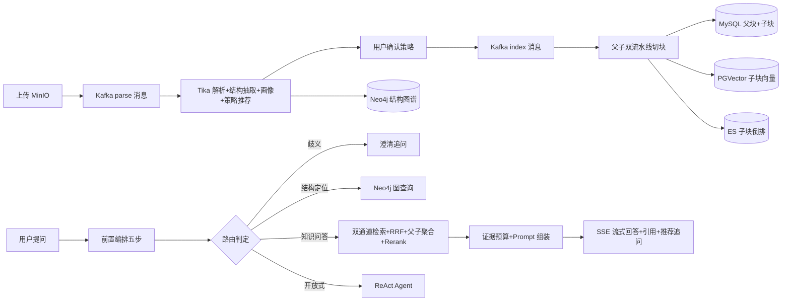

# Agent 架构 + MCP 接工具 + 搭建 RAG

> 基于 `D:\Desktop\claude-understanding\superagent-understanding`(Nexus Agent 企业级多编排 Agent 项目)的源码分析。
> 技术栈:Java 17 + Spring Boot 3.5.6 + Spring AI 1.1.0 + Spring AI Alibaba 1.1.2.0(agent-framework),底层设施为 MySQL、PGVector、Elasticsearch(IK)、Neo4j、Redis、Kafka、MinIO、Tika,前端 Vue 3。

## 项目模块地图

| 模块 | 作用 |
| :--- | :--- |
| `nexus-agent-business/nexus-agent-business-chat` | 主业务:对话编排、三层执行器、RAG 全链路、文档治理、记忆、观测 |
| `ai-example/ai-example-mcp` | MCP 教学示例:`spring-ai-office-mcp-server`(7090)+ `spring-ai-office-mcp-client`(7091) |
| `ai-example/ai-example-rag` | RAG 教学示例:PG/Milvus/Neo4j/混合检索/改写/Rerank 各一个可独立运行的 demo |
| `ai-example/ai-example-memory` | 三种会话记忆策略对比示例 |
| `nexus-agent-redisson-framework` 等 | 自研框架:Redis 租约互斥、延迟队列、ID 生成器 |

主业务代码根:`nexus-agent-business-chat/src/main/java/org/javaup/ai/`,分 `chatagent`(在线对话)、`manage`(文档治理)两大包,配置文件为 `src/main/resources/application.yaml`。

---

# 一、Agent 架构

## 1.1 设计哲学:编排优先,Agent 兜底

核心思路是**"不是让 Agent 自己决定所有事情,而是先用确定性的编排逻辑做好决策,再把执行交给最合适的引擎"**。用户问题先经过一轮纯工程化的编排(改写、路由、歧义检测),产出一个结构化的 `ConversationExecutionPlan`,再按模式分发到执行器。判断优先级:**歧义澄清 > 知识问答 > 开放式 Agent**——知识问答追求"稳"和"可解释"(证据驱动、引用可溯源),只有真正需要联网搜索、多步推理的开放式问题才交给 ReAct Agent 自由探索。

## 1.2 前置编排器(五步决策链)

入口:`chatagent/rag/service/ChatPreparationOrchestrator.java` 的 `prepare(TaskInfo)`,按 Trace 阶段(MEMORY→REWRITE→ROUTE)串行执行:

1. **记忆装载**:`ConversationMemoryService.loadMemoryContext()` 得到长期摘要 + 最近原文窗口;`buildPlanningHistory()` 再拼出结构化规划上下文(会话目标/已确认事实/待跟进问题/检索提示,每节限 5 条),总预算 1600 字符,其中最近原文占约 65%。`TimeSensitiveQueryHelper` 同时判定问题是否需要日期锚定/触发联网搜索。
2. **模式分流**:`chatMode == OPEN_CHAT` 直接产出 `ExecutionMode.REACT_AGENT` 计划返回(天气/新闻/闲聊类词表命中也会引导);DOCUMENT 模式要求用户选定文档,否则报错。
3. **问题改写**:`ChatQueryRewriteService.rewrite()` 用 LLM 做指代消解、上下文补全、口语书面化,并决定是否拆分多问(触发条件:无历史时问题 <8 字、有历史时 <18 字、或显式多问——多问号/分号/编号/含"分别")。参数 temperature=0.2/topP=0.3;LLM 失败降级为规则改写 + 按 `[?？；;\n]` 规则切分;**保守收敛**:LLM 说要拆但原文不像多问时,强制收敛为 1 条,单轮最多拆 4 个子问题。
4. **知识域收缩(仅 AUTO_DOCUMENT 模式)**:`KnowledgeRouteService.route()` 做三级路由(见 3.5 节),confidence≥0.80 取前 3 候选、≥0.55 锁定 Top1 文档;<0.55 或候选分差 ≤3 分且知识域不同 → 判定歧义,计划置为 `CLARIFICATION`,生成澄清文案和前 3 份文档选项让用户选。用户手动选文档时走 `recordShadowRoute` 影子路由(见 3.6 节)。
5. **执行路由**:`DocumentQuestionRouter.route()` 判定结构定位类问题——"上一节/下一节/属于哪个章节/目录展开"等邻接类问题本地规则直接给高置信度(0.86~1.0),拿不准再调 LLM 五分类(ADJACENCY/OUTLINE/ITEM_LOOKUP/CONTENT_QA/ANALYTIC,temperature=0,confidence≥0.75 才采纳);最终决定 `GRAPH_ONLY / GRAPH_THEN_EVIDENCE / RETRIEVAL`,兜底 `RETRIEVAL`。

最终产出的 `ConversationExecutionPlan`(`rag/model/`,20+ 字段)包含:执行模式、改写问题、子问题列表、检索文档范围、历史摘要、回答上下文、导航决策、无证据兜底文案等,交给执行器执行。

## 1.3 执行器体系(三层 + 图查询)

- 接口:`ConversationExecutor` 只有 `mode()` 和 `execute(TaskInfo): Flux<String>` 两个方法,**没有 canHandle**——路由完全由编排器产出的 `ExecutionMode` 枚举决定。
- 注册表:`ConversationExecutorRegistry` 构造时把 Spring 注入的执行器收进 `EnumMap<ExecutionMode, ConversationExecutor>`,`get(mode)` 找不到直接抛异常。
- 六种模式:`GRAPH_ONLY / GRAPH_THEN_EVIDENCE / RETRIEVAL / REACT_AGENT / CLARIFICATION`(+已废弃的 `RAG_CHAT`)。

| 执行器 | 触发条件 | 做什么 |
| :--- | :--- | :--- |
| `ClarificationExecutor` | 问题信息量不足、路由低置信 | 把编排器生成的澄清问题 + 文档选项直接回给用户 |
| `RagChatExecutor` | RETRIEVAL,普通语义问答 | 调 `RagRetrievalEngine` 检索 → 组装证据 Prompt → 流式生成(见 3.7) |
| `GraphOnlyExecutor` | 纯结构定位("下一节是什么") | Neo4j 查兄弟/子章节,`GraphAnswerRenderer` 用中文模板渲染,不调模型 |
| `GraphThenEvidenceExecutor` | "第 X 步/条/项讲了什么" | 先图定位章节和条目,再进检索链路补证据 |
| `ReactAgentExecutor` | OPEN_CHAT 开放式问题 | 驱动 Spring AI Alibaba 的 `ReactAgent` 多轮推理循环 |

## 1.4 ReAct Agent 的完整构建

配置类:`chatagent/config/ChatAgentConfiguration.java#businessChatReactAgent`,基于 `com.alibaba.cloud.ai.graph.agent.ReactAgent`:

```java
ReactAgent.builder()
    .name("business_chat_agent")
    .model(chatModel)                          // OpenAI 兼容协议,阿里云百炼,qwen-plus-latest
    .instruction(chatAgentProperties.getSystemPrompt())
    .tools(tavilySearchToolCallback)           // FunctionToolCallback 注册 tavily_search
    .saver(mysqlCheckpointSaver)               // MysqlSaver checkpoint 持久化
    .parallelToolExecution(true)
    .maxParallelTools(4)
    .hooks(   /* 见下 */  )
    .interceptors( /* 见下 */ )
    .build();
```

**System Prompt 要点**(application.yaml `app.chat.system-prompt`):时效性/事实性问题优先联网搜索,以当前日期理解相对时间;工具不足要声明不确定;信息足够就不再调工具;不向用户暴露工具细节。

**Hook 限流**(防死循环,超出即 `ExitBehavior.END` 结束本轮):

| Hook | 单次运行上限 | 单会话线程累计上限 |
| :--- | :--- | :--- |
| `ModelCallLimitHook` | 8 次 | 40 次 |
| `ToolCallLimitHook`(仅 tavily_search) | 6 次 | 30 次 |

**Interceptor 四件套**:

- `DashScopeCompatibilityInterceptor`:ModelInterceptor,对百炼端点强制 `parallelToolCalls=false`、清空 streamOptions(兼容性修正)。
- `TavilyToolInputFallbackInterceptor`:ToolInterceptor,只拦 `tavily_search`——模型传参为空/纯文本/缺 query 时,用上下文里的原始问题兜底构造 `{"query":...}`,兜底也为空才返回 error。解决小模型工具传参不规范的真实痛点。
- `ToolRetryInterceptor`:指数退避重试,maxRetries=2,初始 200ms、上限 1200ms、带随机抖动,最终失败 `RETURN_MESSAGE`(不让异常直接炸给用户)。
- `ToolErrorInterceptor`:统一兜底收尾。

**唯一工具 `TavilySearchTool`**(`chatagent/tool/`):入参 `TavilySearchRequest{query, topic, maxResults}`(topic 白名单 general/news/finance),POST `https://api.tavily.com/search`(search_depth=advanced,连接 3s/读 6s),出参含 answer + references;副作用是把引用并入 `REFERENCES`、推 thinking 事件、写 `ChatToolTrace`。

## 1.5 Checkpoint 持久化与三种会话记忆

**Checkpoint**:`MysqlSaver.builder().dataSource(...).createOption(CREATE_IF_NOT_EXISTS)`,threadId = conversationId,应用重启后 ReactAgent 可继续之前的推理状态;`ChatCheckpointManager` 负责读取/清理(threadName → graphThreadId → 删 checkpoint + thread)。

**记忆**(`chatagent/service/ConversationMemoryService` + `PersistentConversationMemoryService`),由 `app.chat.history-summary.enabled` 切换:

1. **无记忆(纯滑动窗口)**:只带最近 4 轮原文,窗口裁 2200 字符(超长保留尾部),回答用历史窗 1000 字符。
2. **摘要压缩(生产推荐)**:最近 4 轮原文永不压缩;更早的稳定轮次按 6 轮一批增量调 LLM 合并摘要,摘要负载为结构化 JSON(summary/conversation_goal/stable_facts/user_preferences/resolved_points/pending_questions/retrieval_hints)。字符上限:长期摘要 1400、原文窗口 2200。LLM 失败走规则兜底(正则提取检索提示、每节最多 6 条)。写入 `SuperAgentChatMemorySummary` 表,带版本号 + coveredExchangeId 乐观并发防护;每轮结束后专用线程池异步预热下一轮摘要。

## 1.6 集群并发控制:Redis 租约互斥

`BusinessChatService` + 自研框架 `RedisLeaseManager`:

- 租约 key `chat:running:{conversationId}`,TTL 30s,**每 10s 续期**(SSE 订阅时启动 `Flux.interval` 续期,续期失败主动停止任务)。
- 三个 Lua 脚本实现 CAS:acquire(`exists==0 → PSETEX`)、renew(`get==token → PEXPIRE`)、release(`get==token → DEL`),ownerToken 为每次请求的 UUID——防止误删别人的锁。
- 第二道保险:进程内 `ChatRuntimeRegistry`(`ConcurrentMap.putIfAbsent`)防同进程重入。
- 收尾统一走 cleanup:dispose 流、释放租约、移除注册表;`TaskInfo.finalized` 用 AtomicBoolean CAS 防双收尾;停止生成调 `reactAgent.interrupt(runnableConfig)`。

## 1.7 全链路可观测

- `ObservedChatModelService`:所有非 Agent 的模型调用(改写/摘要/RAG 回答/推荐追问)统一走它,每次记录 stageName、provider、model、tokens(缺失时按字符数/4 估算)、估算成本、耗时、成败。
- `ConversationTraceRecorder`:每次对话一个实例,`startStage/completeStage/failStage` 落库各阶段(MEMORY/REWRITE/ROUTE/RAG_RETRIEVE/ANSWER_GENERATE/REACT_AGENT/RECOMMENDATION/FINALIZE 等)的耗时与快照,失败带完整堆栈;检索通道和每条候选的淘汰原因(如"向量闸门过滤:分数 0.32 < 阈值 0.45")也单独落 `RetrievalObserveStore`。
- **SSE 流式协议**(`StreamEventWriter`):六种事件 `text`(正文 token)/`thinking`(过程说明)/`status`/`error`/`reference`(引用来源)/`recommend`(推荐追问);收尾顺序为正文流结束 → 发引用 → 发推荐追问(主回答后额外调一次模型生成最多 3 个 ≤20 字的追问)→ complete。

---

# 二、MCP 接工具

## 2.1 MCP 在本项目的定位

**主业务(`nexus-agent-business`)没有集成 MCP**——全量 grep 零命中,pom 里只有 `spring-ai-alibaba-agent-framework`、`spring-ai-starter-model-openai`、`spring-ai-rag` 等。主业务的工具调用走 **Function Calling**(`FunctionToolCallback` 注册 `tavily_search`)。

MCP 的完整演示放在教学模块 `ai-example/ai-example-mcp`,分服务端(7090)+ 客户端(7091)两个可独立运行的 Spring Boot 应用,版本坐标由根 pom 统一管理(Spring AI 1.1.0)。

## 2.2 MCP 服务端:声明式暴露工具

依赖只引一个:`org.springframework.ai:spring-ai-starter-mcp-server-webmvc`(**WebMVC + Streamable HTTP 传输**,不是 stdio/SSE 老协议)。

`application.yaml` 关键配置:

```yaml
spring.ai.mcp.server:
  name: office-tools-server
  type: SYNC                      # 同步服务
  protocol: STREAMABLE
  streamable-http:
    mcp-endpoint: /mcp            # MCP 协议端点
    keep-alive-interval: 30s
```

**工具声明用 Spring AI 标准注解**(不是 @McpTool):

```java
@Tool(description = "查询员工考勤记录")
public String checkAttendance(@ToolParam(description = "员工ID") String employeeId,
                              @ToolParam(description = "月份") String month) { ... }
```

- `AttendanceTools`:`checkAttendance`、`clockIn`;`MeetingRoomTools`:`queryRoomSchedule`、`bookMeetingRoom`、`cancelBooking`——返回手拼 JSON 字符串(模拟数据)。
- `McpServerConfig` 用 `MethodToolCallbackProvider.builder().toolObjects(...)` 注册两个 Provider Bean,把工具对象暴露给 MCP 协议层。

## 2.3 MCP 客户端:四种接入方式

客户端依赖 `spring-ai-starter-mcp-client` + `spring-ai-starter-model-openai`(接 SiliconFlow 的 DeepSeek-V3.2)。连接配置:

```yaml
spring.ai.mcp.client:
  type: SYNC
  request-timeout: 60s
  streamable-http.connections.office-tools:
    url: http://localhost:7090
    endpoint: /mcp
  # stdio.connections: (注释掉的备用方式,command+args 拉起本地进程)
```

四种接法(`client/.../service/` 下四个类,难度递进):

1. **自动注入**(`AssistantService`):直接注入 starter 自动装配的 `SyncMcpToolCallbackProvider`,`ChatClient.builder(chatModel).defaultToolCallbacks(provider.getToolCallbacks())` 一行拿到全部工具——最简接法,适合单 Server 场景。
2. **手动构建 McpSyncClient**(`ManualClientService`):`McpClient.sync(HttpClientStreamableHttpTransport.builder(url).endpoint("/mcp").build()).clientInfo(...).requestTimeout(60s).build()` 后手动 `initialize()`。类里还附了 `createStdioClient()`(ServerParameters + StdioClientTransport)和 `createSseClient()`(HttpClientSseClientTransport)两个备用 transport 实现,展示三种传输协议怎么换。
3. **按 Server 过滤工具**(`SelectiveToolService`):注入 `List<McpSyncClient>`,按 `client.getClientInfo().name()` 过滤出指定 Server 的工具再建 Provider,实现多 Server 场景下按领域分组的 ChatClient(如只给"HR 助手"挂考勤工具)。
4. **直连工具绕过 LLM**(`DirectToolService`):匹配到 client 后直接 `client.callTool(CallToolRequest.builder().name(toolName).arguments(params).build())`,不经 ChatClient/模型——适合把 MCP 工具当普通 RPC 用的场景。

## 2.4 MCP vs Function Calling 对比

| 维度 | 主业务 Function Calling | ai-example MCP |
| :--- | :--- | :--- |
| 工具注册 | `FunctionToolCallback.builder()` 硬编码在应用内 | 外部独立进程,标准协议动态发现 |
| 工具声明 | Java 方法 + JSON Schema description | `@Tool/@ToolParam` 注解 + MethodToolCallbackProvider |
| 调用链 | ReactAgent 循环内直调 | SyncMcpToolCallbackProvider 代理 → HTTP → Server |
| 进程边界 | 同 JVM | 跨进程(Streamable HTTP / stdio / SSE) |
| 适用场景 | 内部固定工具、低延迟 | 跨团队/跨语言工具复用、热插拔 |

---

# 三、搭建 RAG

RAG 在本项目分**离线入库链路**(文档治理)和**在线问答链路**(检索 + 证据生成)两大段,外加知识路由闭环。



## 3.1 离线入库:Kafka 异步双段流水线

消息只做"触发器"(消息体仅 `{documentId, taskId, planId}`),真实数据全在 MySQL。topic:`nexus-agent-document-parse-route` / `nexus-agent-document-index-build`,以 documentId 为 key 保证同文档有序。

**第一段 parse 流水线**(`DocumentAsyncProcessServiceImpl.handleParseRoute`,阶段 FILE_UPLOAD→CONTENT_PARSE→STRATEGY_ROUTE):

1. 从 MinIO 下载原文件,`TikaDocumentParserService` 统一解析出 `DocumentAnalysisResult`(清洗文本、字数/token、结构等级、质量等级、标题数、结构节点等)。
2. 解析纯文本回传 MinIO(`rag/parsed-text` 前缀),结构节点全删重插 MySQL。
3. 同步导航 ES 索引 + 投影 Neo4j 图谱。
4. `generateProfile` 生成文档画像(摘要/核心主题/示例问题),`recommendStrategy` 产出切块策略推荐,写 `SuperAgentDocumentStrategyPlan`(planSource=SYSTEM_RECOMMEND,状态 WAIT_CONFIRM,快照格式 `PARENT:1,2;CHILD:3,4`)。

**第二段 index 流水线**(用户确认策略后触发,阶段 CHUNK_EXECUTE→CHUNK_POST_PROCESS→VECTORIZE→STORE_COMPLETE):父块先建 → 子块再切 → 三处落库(MySQL 明细 + PGVector 向量 + ES 倒排)→ 回写 vectorStatus。每步写 `SuperAgentDocumentTaskLog`,失败可精确定位。

## 3.2 组合式切块引擎(四策略流水线)

`DocumentStrategyServiceImpl`,四策略不是四选一而是按角色组合:

| 策略 | 角色 | 实现要点 |
| :--- | :--- | :--- |
| 结构切块 | 主干 | `DocumentLineClassifier` 正则行分类(Markdown #/多级数字/中文章节/"一、"/附录/列表),标题栈拼 `sectionPath(A>B>C)` |
| 递归分块 | 兜底 | 四级级联:空行分段→单换行→句切分(`(?<=[。！？!?；;])`)→固定滑窗;贪心合并后把上一块尾部 overlap 字符拼到下一块头部 |
| 语义分块 | 优化 | 相邻句 Jaccard 相似度(汉字单字+英文词分词),断句条件:`块长≥min 且 jaccard<0.18` 或超 max |
| LLM 切块 | 增强(默认关) | 超 3500 字先递归预切,提示词让 LLM 返回 `[...]` JSON 数组;失败回退语义切块 |

**关键参数**(父/子两条流水线独立配置):父块上限 2200 字(overlap 180)、递归 800/120、语义子块 240~700(相似度阈值 0.18)、LLM 块 3500。

**推荐逻辑**:父流水线——PDF/DOC/MD/HTML 且结构等级≥MEDIUM 或标题数≥2 → 结构切块,否则递归;子流水线——低质量文档推 LLM,结构清晰推语义,再按文档长度追加递归兜底(保证子流水线非空)。

## 3.3 Parent-Child 双粒度存储

- **Parent 块**:MySQL `nexus_agent_document_parent_block`(parentText、charCount、tokenCount 估算、childCount、start/endChunkNo)。有结构节点时用"有内容的 SECTION 节点"作种子,否则整篇作单一种子。
- **Child 块**:三处存储——MySQL `nexus_agent_document_chunk` 明细(chunkNo 全局递增、parentBlockId、vectorStatus)、**PGVector `nexus_agent_document_embedding`**(主键直接复用 MySQL chunk id,`CAST(? AS vector)` 写向量字面量,metadata_jsonb 存 14 个字段;embedding 用 DashScope `text-embedding-v4`,列类型 VECTOR 不固定维度以兼容模型更换)、**ES `nexus_agent_document_keyword` 索引**(写入 ik_max_word、搜索 ik_smart,chunkText/sectionPath/documentName 为 text,过滤字段为 keyword)。
- 设计意图:**检索用 Child 小块保命中率,回答聚合到 Parent 大块保上下文完整**。

## 3.4 Neo4j 结构图谱

`Neo4jDocumentStructureGraphProjectionService`(写侧):每次入库同事务内 `DETACH DELETE` 该文档全部节点后重建:

- 节点:`(:Document)` / `(:Section{depth,nodeCode,title,sectionPath,canonicalPath,contentText,normalizedTitle})` / `(:Item{nodeType,itemIndex})`
- 关系:`HAS_SECTION`(Document→顶层 Section)、`HAS_CHILD`(嵌套)、`HAS_ITEM`(Section→Item)、反向 `BELONGS_TO_DOCUMENT/BELONGS_TO_SECTION`、兄弟序 `NEXT_SIBLING/PREV_SIBLING`、`NEXT_ITEM/PREV_ITEM`
- 预建索引:documentId、(documentId,nodeId)、(documentId,normalizedTitle)、(documentId,sectionPath,itemIndex) 等
- 读侧 `Neo4jDocumentStructureGraphService`:`findBestSection` 打分(topic 命中 title+8/anchorText+6/content+2)、listChildren、兄弟遍历、按 itemIndex 找条目;**Neo4j 不可用时自动降级 MySQL 结构节点表**(`CompositeDocumentStructureGraphService`)。

## 3.5 三级知识路由漏斗(Scope → Topic → Document)

`KnowledgeRouteServiceImpl`——注意这是**嵌入向量 + 词面混合打分的工程路由,不是 LLM 调用**。查询上下文 = 原问题 + 改写问题;分词 = 分隔符切词(≥2 字)+ 中文 2~6 元 n-gram,上限 40 词;每级统一打分公式:

```
score = (cos余弦相似度 - 0.20) × 50          ← 语义主分,门槛 0.2
      + min(10, ES路由索引得分 × 1.6)         ← 词面辅助
      + 6 × 实体型词命中数(含字母数字或 ≤4 字的词)
      + 结构加成(如:文档 scopeCode == Top1 scope +15;
                 文档在 Top1 topic 的关系表中 + relationScore×20)
```

- Scope 层(知识域,取 Top5):scope 档案 = 名称+描述+别名+示例问题拼接后 embed;Topic 层(取 Top8):scope 命中加 8;Document 层(取 Top5):文档档案 = 名称+类目标签+画像,仅 BUILD_SUCCESS 状态参评。
- 置信度 `confidence = top / max(10, top + second + 5)`;无候选 → FAILED,<0.55 → LOW_CONFIDENCE(触发澄清追问)。
- **影子路由**:用户手动选文档时,后台照样跑一遍路由,把系统推荐与用户实际选择写入 `nexus_agent_knowledge_route_trace` 表(hitSelectedDocument = 用户选中文档是否在系统 Top3 中),离线对比持续评估路由质量。

## 3.6 在线检索:双通道 + RRF + 父子聚合

`RagRetrievalEngine`(线程池 8 线程、队列 256、CallerRuns):

1. **子问题并行**:每个子问题一个 `CompletableFuture`,`orTimeout(12s)`,超时降级为空证据并记 note。
2. **双通道再并行**(单通道超时 5s,失败不拖垮整体):
   - **向量通道**(PGVector):`SELECT ..., 1 - (embedding <=> CAST(? AS vector)) AS similarity FROM nexus_agent_document_embedding WHERE document_id IN(...) ORDER BY embedding <=> ? LIMIT 8`,强制文档/任务范围过滤,支持 sectionPath LIKE 收缩。
   - **关键词通道**(ES):bool 查询——filter(documentId/taskId terms + sectionPath wildcard)+ should(matchPhrase sectionPath^8 / chunkText^5 / documentName^4 + multiMatch 业务类目^5/标签^4 等,minimum_should_match=1);ES 关闭时回退 PG 的 LIKE 加权打分 SQL。词项用 n-gram 提取(去"请问/怎么"噪声词),上限 8 个。
3. **证据闸门**:向量通道绝对阈值 `score ≥ 0.45`;关键词通道用**相对阈值** `topScore × 0.35`(BM25 量纲不稳,不用绝对值)。
4. **RRF 融合**:公式 `score = Σ 1/(60 + rank)`(K=60,代码常量),同文档出现在两通道标记 hybrid,截 Top10 候选。
5. **Parent 提升**(`elevateToParentBlocks`):按 child 的 parent_block_id 分组回捞父块,父块分数 = `bestChildScore × (1 + min(0.36, 命中子块数-1 × 0.12) + 跨双通道 0.10)`;父块文本 = `[父块内容] + [命中子片段]`(整体裁到 2200 字)。
6. **外部 Rerank**(可选):POST `https://api.siliconflow.cn/v1/rerank`,模型 `BAAI/bge-reranker-v2-m3`,top_n=5,连接 3s/读 6s;两层开关(引擎层 rerank-enabled + 处理器层 enabled),apiKey 缺失/异常/格式错误一律回退原始排序。
7. **定稿**:截 finalTopK=5,`assignReferenceIds()` 按唯一键(PARENT:parentId / DOCUMENT:chunkId / WEB:url)全局编号 [1..N] 去重复用。

## 3.7 证据预算、Prompt 组装与无证据短路

`RagPromptAssemblyService`:

- **预算控制**:总预算 5200 字符 + 单子问题预算 2200 字符,`tryConsume` 双检查,放不下即截断并追加省略提示;文档引用块模板 `[编号] 文档:X;章节:Y + 内容(snippet 截 1100 字)`,重复引用渲染为"复用证据 [n]"(也占预算)。
- **系统提示词**(`rag-answer-system.st`):严格基于证据、不得编造、历史上下文仅用于指代消解、多子问题按编号逐一作答、**句末标注 [1][2] 引用编号**。
- **无证据短路**:所有子问题 references 均为空 → 不调模型,直接返回兜底文案("当前没有从当前文档中检索到足够证据……你可以补充更具体的章节名、标题或关键词后再试"),并按问题类型分型引导(能力类问题引导切开放式 Agent)。这是防幻觉最直接的手段。
- **SSE 收尾**:正文流式推送结束后补发 `reference`(引用来源)+ `recommend`(最多 3 个推荐追问)。

## 3.8 结构定位的图查询回答

`GRAPH_ONLY`:`StructureGraphQueryEngine` 查邻接(`findSectionWithSiblings` 含父/前/后)或目录(`findSectionWithChildren`),`GraphAnswerRenderer` 用中文模板渲染("「X」包含以下章节:- …"),**不调大模型**;`GRAPH_THEN_EVIDENCE`:先图定位章节 + 按条目编号/关键词找 item,再进检索链路补证据。图查询无证据时同样走兜底文案。

---

# 四、总结:这套设计的可借鉴点

1. **编排与执行分离**:LLM 只负责"内容",路由/改写/拆分/预算全部工程化前置,产出结构化执行计划——可解释、可观测、可测试。
2. **三层执行器按场景分流**:歧义先追问、知识问答走证据驱动、开放式才放 Agent,避免"什么都让 Agent 自由发挥"的不可控。
3. **Agent 护栏成体系**:模型/工具调用双 Hook 限流(run 级 + thread 级)、指数退避重试、错误兜底、输入参数兜底拦截器、checkpoint 持久化、Redis 租约集群互斥——每一层都对应一类真实生产事故。
4. **检索是"漏斗"不是"一次查询"**:知识域三级收缩 → 双通道并行 → 闸门过滤 → RRF 融合 → 父子聚合 → Rerank 精排 → 预算裁剪,每层都有阈值和淘汰原因落库。
5. **防幻觉靠机制**:无证据短路 + 强制引用编号 + 证据预算 + 相对阈值闸门,而不是靠提示词祈祷。
6. **知识是"闭环"不是"资产"**:影子路由把用户选择沉淀为路由质量观测数据,反哺路由优化。
7. **MCP 与 Function Calling 是互补而非替代**:进程内固定工具用 Function Calling(低延迟),跨进程/跨团队能力用 MCP(动态发现、热插拔),项目用两个独立示例把两种方式都讲清了。
